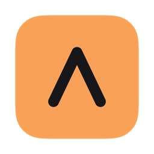
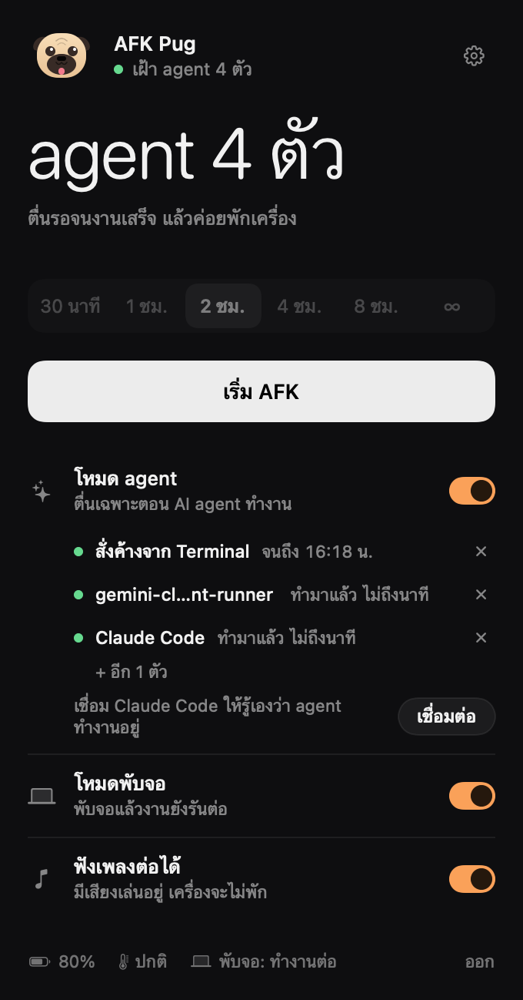

<p align="center">
  
</p>

<h1 align="center">AFK Pug</h1>

<p align="center">
  <b>Close the lid. Your agents keep running. AFK Pug keeps watch.</b>
</p>

<p align="center">
  
  
  
  
  
</p>

<p align="center">
  <a href="#features">Features</a> ·
  <a href="#install">Install</a> ·
  <a href="#quick-start">Quick start</a> ·
  <a href="#works-with-your-agents">Agents</a> ·
  <a href="#safety">Safety</a> ·
  <a href="#faq">FAQ</a> ·
  <a href="README.th.md">ภาษาไทย</a>
</p>

---

You ask Claude Code to refactor a module, close your MacBook, and walk to lunch. When you come back, nothing happened: the Mac went to sleep the moment the lid shut.

**AFK Pug** is a tiny menu bar app that keeps your MacBook awake with the lid closed, with no external display, on battery or power. It knows when your AI agents are actually working, turns the screen off so the battery lasts, and lets the Mac sleep again as soon as the work is done.

<p align="center">
  
  &nbsp;&nbsp;
  
</p>

## Features

### Stay awake, lid closed
- **One click.** Pick 30m, 1h, 2h, 4h, 8h or ∞ and press **Go AFK**. Add 30 minutes or stop at any time.
- **No monitor, no dongle.** Works with the lid closed on battery or on power.
- **Shortcut.** <kbd>⌥</kbd> <kbd>⌘</kbd> <kbd>A</kbd> starts or stops AFK from any app.
- **Sleep now.** When music, the charger or the grace period is keeping the Mac awake, one click lets it sleep; those triggers stay quiet until they stop and start again.
- **Opens at login**, so agent mode keeps working after a restart (toggle in Settings → General).

### Knows when your agents work
- **Agent mode.** Awake only while Claude Code (or another agent) is working. An idle session at the prompt doesn't count, so the Mac sleeps normally.
- **Grace period.** Waits 2, 5 or 15 minutes after the last agent finishes, in case you send another prompt.
- **Smart about Claude Code.** Background tasks still running after Claude's reply keep the Mac awake. An interrupted turn (Esc) or an API error lets it sleep. A "finished" notification only fires once the agent has really stopped.
- **Notifications.** Tells you when an agent finishes, needs a permission or hits an error. Optional push to your phone through [ntfy](https://ntfy.sh).

### Easy on the battery
When the lid closes, AFK Pug:
- turns the built-in screen off (and keeps it off, since Apple Silicon can leave it lit under the lid),
- mutes sound, unless music is playing,
- turns on Low Power Mode on battery,
- can pause chat apps such as Slack, Discord and LINE,
- locks the screen so nobody can use your Mac while you're away.

Everything is put back when you open the lid, along with a short **"While you were away"** summary: time closed, battery used, agent turns finished and peak temperature.

### Music keeps playing
YouTube, Spotify or Apple Music playing? AFK Pug notices the audio (and shows which app), keeps the Mac awake with the sound on, and ignores short gaps between tracks. With the lid closed, audio only counts if it was already playing when you closed it, so an idle browser tab can't keep a Mac in a bag awake.

### Starts by itself
- when the charger is connected,
- while apps you choose are open (names as shown in the Dock, for example `Xcode, Docker Desktop, OBS`).

### Speaks your language
Thai and English, switchable in Settings. Follows your macOS language by default.

## Install

AFK Pug isn't on the App Store yet. Build it from source:

```sh
git clone https://github.com/Pug-03/AKF_Pug.git
cd AKF_Pug
scripts/build.sh --install   # builds, copies to /Applications and launches
```

Requirements: an Apple Silicon MacBook, macOS 14 or later, and Xcode or the Swift 5.10+ toolchain.

The app is ad-hoc signed. If macOS blocks it the first time, open **System Settings → Privacy & Security** and choose **Open Anyway**.

## Quick start

1. Click the pug in the menu bar.
2. Next to **Lid-closed mode**, press **Set up** and enter your password once.
3. Press **Connect** to link Claude Code.
4. Start a task in Claude Code and close the lid.

If you use Amphetamine or a similar app, quit it so the two don't fight over sleep.

## Works with your agents

| Agent | How AFK Pug knows it's working |
|---|---|
| Claude Code | Lifecycle hooks (`UserPromptSubmit`, `PreToolUse`, `PostToolUse`, `Stop`, `Notification`, `SessionEnd`), installed in one click. A hold with no activity for 15 minutes is dropped, unless Claude's process is still busy |
| Codex, Gemini CLI, Cursor Agent, Aider, OpenCode, Amp, Goose, Qwen Code | Process detection: counts as working while the process tree uses CPU |
| Anything else | The `afkpug` command line tool |

### Command line

The CLI is installed at `~/.afkpug/bin/afkpug`. Add it to your PATH:

```sh
export PATH="$HOME/.afkpug/bin:$PATH"
```

```sh
afkpug run -- npm run build              # keep awake while a command runs (exit code and Ctrl-C pass through)
afkpug hold --for 1h30m --reason deploy  # 90s, 45m, 2h, 1h30m; a bare number means minutes; max 24h
afkpug release                           # drop CLI and agent-tool holds
afkpug status                            # is the app running, and every hold with time left
```

### URL commands

For Shortcuts, Raycast, Alfred or scripts:

```sh
open "afkpug://start?minutes=90"   # 0 = until you stop
open "afkpug://stop"
open "afkpug://toggle"
open "afkpug://sleep-now"
```

### Let the agent ask (MCP)

Under **Settings → Agents → Let agents keep the Mac awake**, AFK Pug registers an MCP server with Claude Code. The agent then gets three tools:

| Tool | What it does |
|---|---|
| `keep_mac_awake` | Stay awake for 1–720 minutes, with a reason |
| `release_mac_awake` | Drop the holds this session created |
| `afk_status` | List what's keeping the Mac awake |

Useful when a build or deploy keeps running after the agent's reply.

## Safety

A closed MacBook that keeps working sheds heat more slowly, so AFK Pug has several guards:

- **Battery floor.** Stops at 15% on battery (adjustable from 5% to 50%) and lets the Mac sleep.
- **Heat.** Turns on Low Power Mode when the Mac gets hot and always stops at critical temperature. This guard can't be turned off.
- **Crash-safe.** If the app quits or crashes, a launchd watchdog restores normal lid sleep within 30 seconds and resumes any paused apps. The next launch checks again.
- **Narrow permission.** The one-time setup adds a sudoers rule for exactly six commands: `pmset -a disablesleep 0|1`, and `pmset -b|-c lowpowermode 0|1` for the current power source only, so your own Low Power Mode settings are kept. Remove it any time from Settings.

Keep the Mac on a hard, ventilated surface. Don't put it in a bag while it's awake.

## How it works

| Situation | Mechanism |
|---|---|
| Lid open | IOKit `PreventUserIdleSystemSleep` assertion, the same thing `caffeinate -i` uses |
| Lid closed | `pmset -a disablesleep 1`, re-checked every few seconds and always paired with `disablesleep 0` |
| Agent state | Hooks write small files to `~/.afkpug/holds` and `~/.afkpug/events`. The app polls every 2 seconds |
| Music | CoreAudio reports whether the default output device is in use |
| Screen off | `pmset displaysleepnow`, repeated while the lid stays closed |

`caffeinate` alone isn't enough: closing a MacBook lid triggers a separate sleep path that idle-sleep assertions don't block.

## FAQ

<details>
<summary><b>Does the internet stay connected with the lid closed?</b></summary>
<br>
The Mac doesn't go to sleep, so Wi-Fi normally stays connected and downloads, SSH and syncs keep going. A weak connection, such as a phone hotspot, can still drop on its own.
</details>

<details>
<summary><b>How is this different from Amphetamine?</b></summary>
<br>
Amphetamine keeps the Mac awake for a set time. AFK Pug also turns the screen off and mutes sound when the lid closes, knows whether your agents are working, and lets the Mac sleep as soon as they're done.
</details>

<details>
<summary><b>What if I forget to turn it off?</b></summary>
<br>
Timers end on their own, agent mode ends when the work does, and quitting the app restores normal sleep. If the app crashes, the watchdog restores it within 30 seconds.
</details>

<details>
<summary><b>Does it send any data anywhere?</b></summary>
<br>
No. Everything stays on your Mac. The only network request is the optional phone notification, which goes to the ntfy topic you enter.
</details>

## Uninstall

**Settings → Uninstall AFK Pug…** removes the Claude Code hooks, the MCP registration, the watchdog, the lid-closed permission and `~/.afkpug`, restores normal sleep, and quits. Then delete the app. Your original `~/.claude/settings.json` is kept as `settings.json.afkpug-backup`.

## Testing

A headless simulator drives the engine with fake lid, battery, heat, audio and process input. Nothing real runs: every power command is logged instead.

```sh
AFKPUG_SIM=1 AFKPUG_SIM_DIR=$(mktemp -d) "$(swift build --show-bin-path)/AFKPug" --simulate all      # 37 scenarios
AFKPUG_SIM=1 AFKPUG_SIM_DIR=$(mktemp -d) "$(swift build --show-bin-path)/AFKPug" --simulate stress   # 49 adversarial scenarios
```

## Roadmap

- [ ] Signed and notarized release download, Homebrew cask, auto-update (needs an Apple Developer ID)
- [ ] Privileged helper (SMAppService) instead of a sudoers rule (needs signing)
- [ ] Native hooks for Codex, Cursor and Gemini CLI (today: process detection)
- [ ] Stay awake until a Claude usage limit resets
- [ ] PushPug integration

## Project layout

```
Sources/AFKPug/
├── App.swift           entry point, menu bar, URL commands, --mcp / --simulate / render modes
├── Engine.swift        session logic: timers, agents, guards, lid actions
├── PowerControl.swift  pmset, IOKit assertions, one-time setup
├── Sensors.swift       lid, battery and thermal state
├── Agents.swift        holds, events, Claude Code hooks, watchdog
├── Extras.swift        process detection, chat pause, lock, hotkey, ntfy, MCP, audio
├── Scripts.swift       hook, CLI and watchdog shell scripts
├── Views.swift         home screen
├── Settings.swift      settings screen and shared controls
├── PugArt.swift        the pug, app icon and menu bar icon
├── L10n.swift          Thai and English strings
└── Simulation.swift    headless test scenarios
```

## Credits

Made by [Pug-03](https://github.com/Pug-03), who also made [PushPug](https://github.com/Pug-03/PushPug). The pug is drawn entirely in SwiftUI.
