<p align="center">
  
</p>

<h1 align="center">AFK Pug</h1>

<p align="center">
  <b>Close the lid. Your agents keep running. AFK Pug keeps watch.</b>
</p>

<p align="center">
  <a href="https://github.com/Pug-03/AFK_Pug/releases/latest"></a>
</p>

<p align="center">
  <a href="https://github.com/Pug-03/AFK_Pug/actions/workflows/ci.yml"></a>
  
  
  
  
</p>

<p align="center">
  <a href="#what-it-does">What it does</a> ·
  <a href="#installation-guide">Installation guide</a> ·
  <a href="#what-youll-see-and-what-to-do">What you'll see</a> ·
  <a href="#features">Features</a> ·
  <a href="#settings">Settings</a> ·
  <a href="#safety">Safety</a> ·
  <a href="#troubleshooting">Troubleshooting</a> ·
  <a href="README.th.md">ภาษาไทย</a>
</p>

<p align="center">
  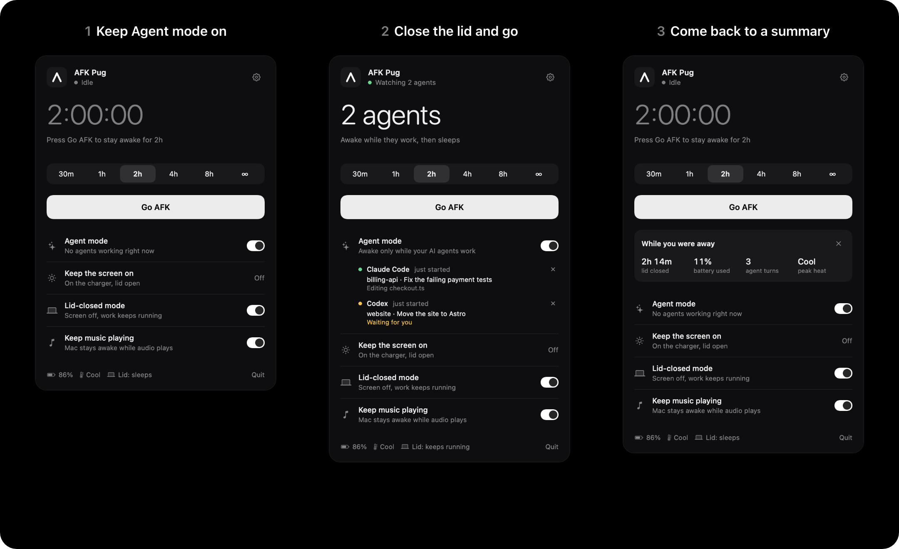
</p>

---

## What it does

You ask Claude Code to refactor a module, close your MacBook and walk to lunch. When you come back, nothing has happened: the Mac went to sleep the moment the lid shut.

**AFK Pug is a small menu bar app that keeps your MacBook working with the lid closed**, with no external display, on battery or on power. It knows when your AI agents are really working, turns the screen off to save battery, and lets the Mac sleep as soon as the work is done.

<p align="center">
  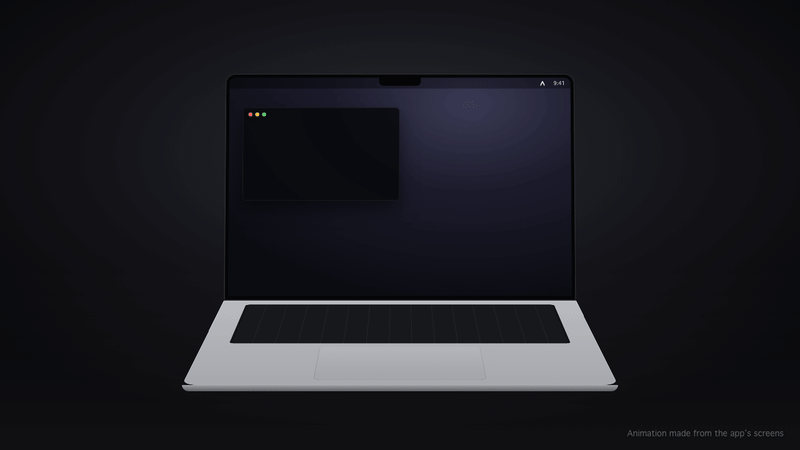
  <br>
  <sub>An animation made from the app's screens, not a screen recording.</sub>
</p>

- **Works with the lid closed:** no monitor or dongle needed
- **Follows your agents:** Claude Code, Codex, Gemini CLI, Cursor and more
- **Waits out a Claude usage limit:** stays awake until the reset, so the task can continue
- **Easy on the battery:** screen off, sound muted, Low Power Mode, all restored when you open the lid
- **Keeps music playing:** a track that's already on stays on
- **Has hard limits:** stops at low battery or critical heat, and restores normal sleep even if the app crashes
- **Looks how you like:** white, black or any background, with your own accent color
- **Stays on your Mac:** no account and no telemetry

---

## Installation guide

Most people need **Before you start**, **A** and **C**. It takes about two minutes.

| Part | What it covers | Who needs it |
|---|---|---|
| [Before you start](#before-you-start) | your Mac and macOS version | everyone |
| [A. Download the app](#a-download-the-app) | download, move to Applications, first open | everyone |
| [B. Build it yourself](#b-build-it-yourself) | from the source code | developers |
| [C. The welcome window](#c-the-welcome-window) | permission and connecting your agents | everyone |
| [D. Find the menu bar icon](#d-find-the-menu-bar-icon) | where AFK Pug lives | everyone |
| [E. Claude Code plugin](#e-claude-code-plugin-optional) | hooks without editing your settings file | optional |
| [Update or uninstall](#update-or-uninstall) | newer versions, removing it | later |

### Before you start

Open the Apple menu and choose **About This Mac**. You need:

- **Chip:** Apple M1 or newer. Intel Macs aren't supported.
- **macOS:** 14 Sonoma or newer.

If you use Amphetamine or a similar app, quit it so the two don't fight over sleep.

### A. Download the app

**A1. Download.** Open the [latest release](https://github.com/Pug-03/AFK_Pug/releases/latest), scroll to **Assets** and click **`AFK-Pug.zip`** **(1)**.

<p align="center">
  <picture>
    <source media="(prefers-color-scheme: dark)" srcset="docs/guide/download-dark.png">
    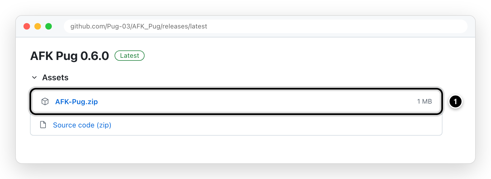
  </picture>
</p>

**A2. Move it to Applications.** Open **Downloads** and double-click the zip if it wasn't unpacked for you. Drag **AFK Pug** into **Applications** **(2)**. It has to be there: agent hooks and the Claude Code plugin look for it in that folder.

<p align="center">
  <picture>
    <source media="(prefers-color-scheme: dark)" srcset="docs/guide/drag-dark.png">
    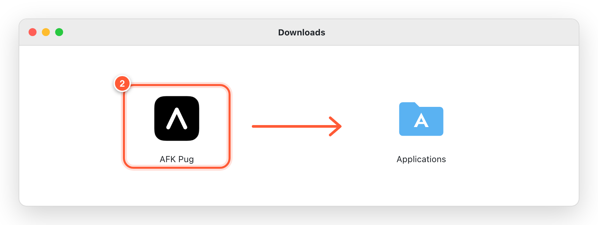
  </picture>
</p>

**A3. Open it the first time.** Double-click AFK Pug in Applications. macOS stops it, because the app isn't signed with a paid Apple Developer ID yet. Press **Done** **(3)**, not *Move to Trash*.

<p align="center">
  <picture>
    <source media="(prefers-color-scheme: dark)" srcset="docs/guide/blocked-dark.png">
    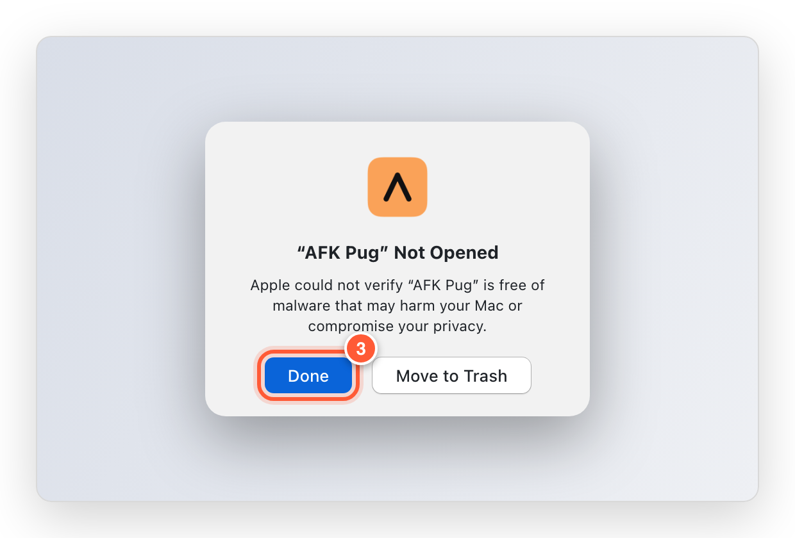
  </picture>
</p>

**A4. Allow it.** Open **System Settings → Privacy & Security** **(4)**, scroll down to **Security** and press **Open Anyway** **(5)**. Confirm with your password or Touch ID, then press **Open Anyway** once more. You only do this once.

<p align="center">
  <picture>
    <source media="(prefers-color-scheme: dark)" srcset="docs/guide/anyway-dark.png">
    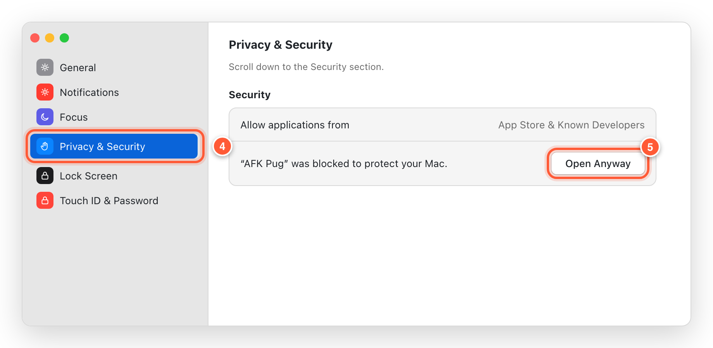
  </picture>
</p>

The welcome window opens next. Go to [C. The welcome window](#c-the-welcome-window).

<details>
<summary><b>On macOS 14 Sonoma, or no Open Anyway button?</b></summary>
<br>

On macOS 14 the dialog's wording is different, but the button in **Privacy & Security** works the same way. You can also Control-click the app in Applications, choose **Open**, then press **Open** again.

Open Anyway only appears for about an hour after the blocked attempt, so open the app again if it's missing. If you trust this download and still have no button, run this in Terminal:

```sh
xattr -dr com.apple.quarantine "/Applications/AFK Pug.app"
```

</details>

### B. Build it yourself

Needs Xcode 16 or newer, or its command line tools from `xcode-select --install`. Check with `swift --version`.

```sh
git clone https://github.com/Pug-03/AFK_Pug.git
cd AFK_Pug
scripts/build.sh --install   # builds, copies to /Applications and launches
```

You don't need A3 or A4: macOS only blocks apps that were downloaded.

### C. The welcome window

The welcome window opens by itself on first launch. Every step can be skipped. To open it later: **Settings → General → Show welcome again**.

| Step | What to do |
|---|---|
| **1. Meet AFK Pug** | press **Continue** |
| **2. Lid-closed mode** | press **Allow** and enter your password. Asked once, and it only permits [these commands](#safety) |
| **3. Connect your agents** | press **Connect** next to each agent you use. Installed agents show the button |
| **4. You're all set** | keep **Agent mode** and **Open at login** on, then press **Done** |

<p align="center">
  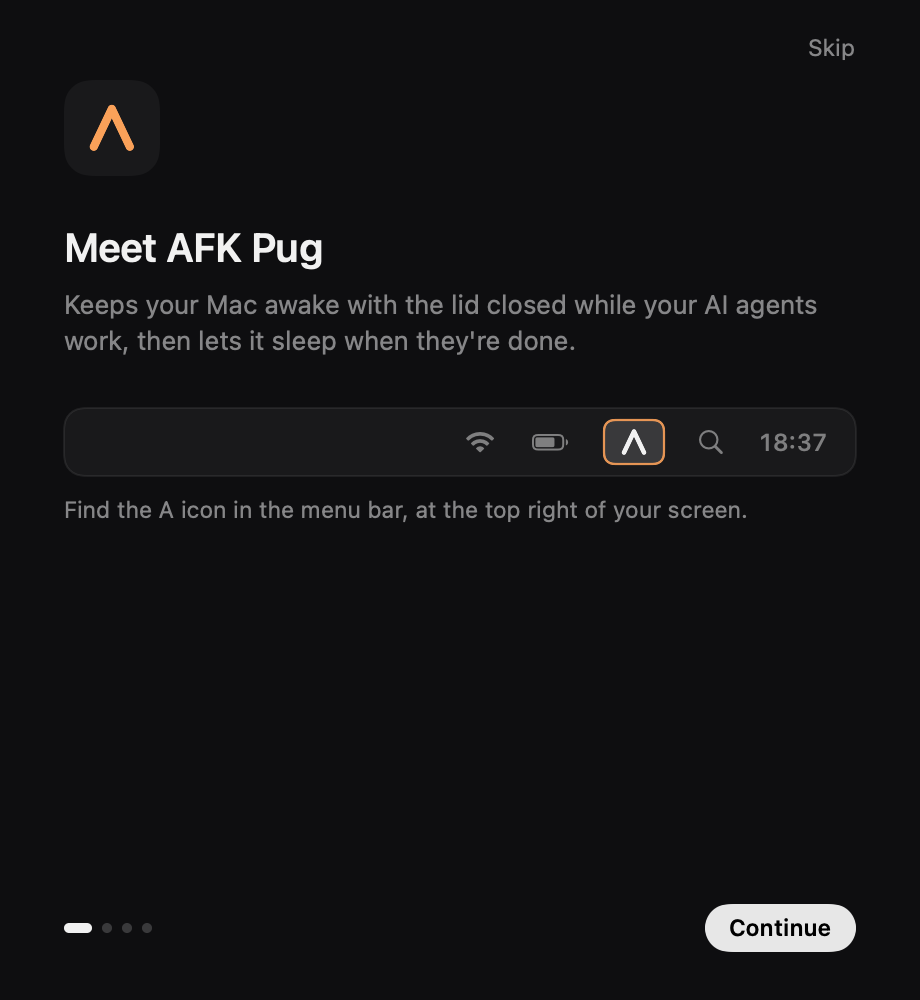
  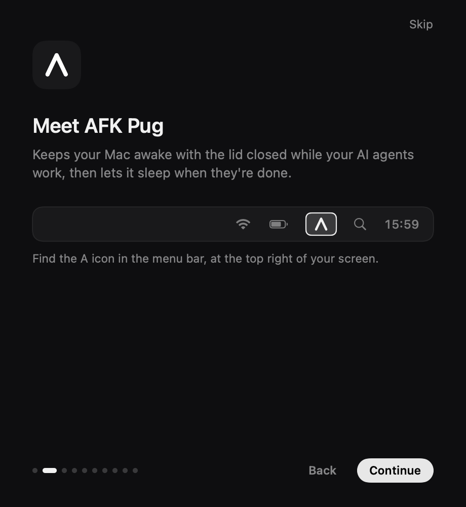
  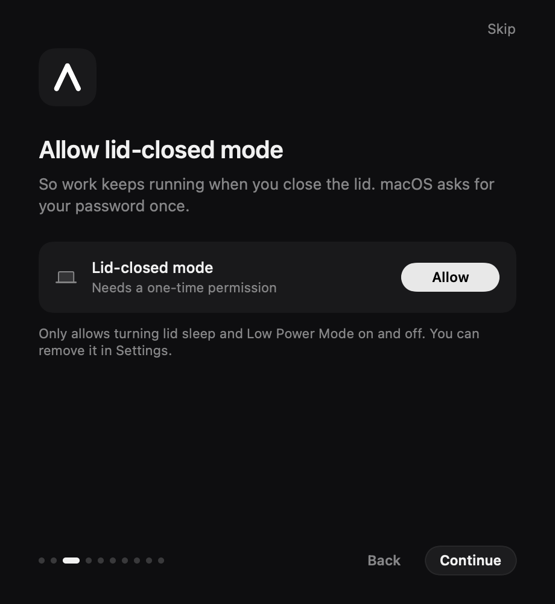
</p>

> **Codex users:** Codex only runs new hooks after you trust them. Open Codex and type `/hooks`. Until then, AFK Pug detects Codex from its running process.

**Try it:** start a task in your agent and close the lid. That's all.

### D. Find the menu bar icon

AFK Pug has no Dock icon. It lives in the menu bar at the top right of your screen, as the letter **A** **(1)**. Click it to open the app. While the Mac is being kept awake, the A gains a crossbar.

<p align="center">
  <picture>
    <source media="(prefers-color-scheme: dark)" srcset="docs/guide/menubar-dark.png">
    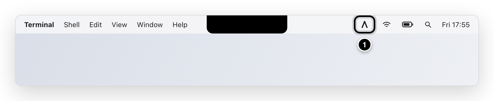
  </picture>
</p>

Can't see it? See [The A icon is missing](#the-a-icon-is-missing).

### E. Claude Code plugin (optional)

Instead of letting the app edit `~/.claude/settings.json`, you can add the hooks and the MCP server as a Claude Code plugin. Install the app in `/Applications` first, then in Claude Code:

```
/plugin marketplace add Pug-03/AFK_Pug
/plugin install afk-pug@afk-pug
```

Remove it with `/plugin uninstall afk-pug`. With the plugin installed, Settings shows Claude Code as connected and the MCP row as provided by the plugin.

### Update or uninstall

**Update:**

| You installed it… | To update |
|---|---|
| **by downloading** (A) | AFK Pug checks once a day and shows a card when there's a new version. Press **Update**: it downloads the new version, checks it, quits and reopens. Your settings stay. To look right away: **Settings → General → Check now** |
| **by building it** (B) | In the `AFK_Pug` folder: `git pull`, then `scripts/build.sh --install` |

On 0.5.0 or older, or if the app isn't in Applications, download the newer zip from [Releases](https://github.com/Pug-03/AFK_Pug/releases/latest) and replace the app by hand.

**Uninstall:** **Settings → Uninstall AFK Pug…** removes the hooks from all four agents, the MCP registration, the watchdog, the login item, the lid-closed permission and `~/.afkpug`, restores normal sleep and quits. Then delete the app from Applications.

Your original config files stay beside the originals as `<file>.afkpug-backup`, for example `~/.claude/settings.json.afkpug-backup`. The Claude Code plugin is removed separately, with `/plugin uninstall afk-pug`.

---

## What you'll see, and what to do

Click the A in the menu bar. The big line at the top always tells you why the Mac is awake, or that it isn't.

<table>
<tr><td colspan="2"><h3>Ready</h3></td></tr>
<tr>
<td width="250" valign="top">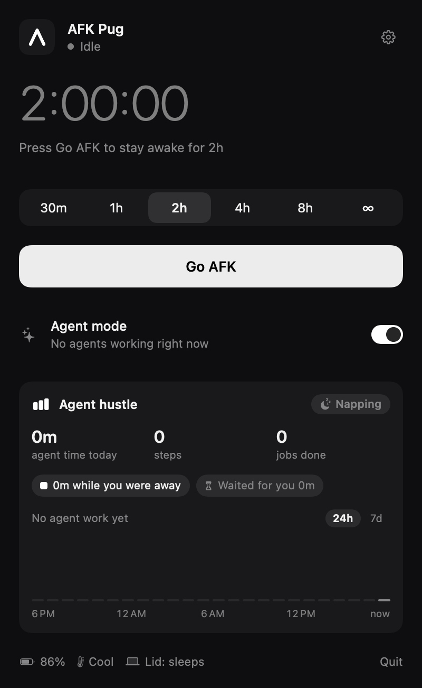</td>
<td valign="top">

**What it means:** nothing is keeping the Mac awake, so it sleeps normally. With **Agent mode** on, AFK Pug starts by itself when an agent works.

**What to do:** nothing. To keep the Mac awake without an agent, pick a time and press **Go AFK**.

</td>
</tr>

<tr><td colspan="2"><h3>Finish setup</h3></td></tr>
<tr>
<td valign="top">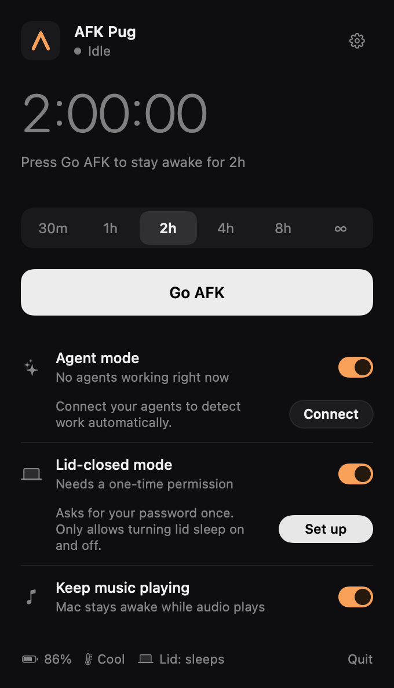</td>
<td valign="top">

**What it means:** you skipped a welcome step. Without the permission, the Mac still sleeps when the lid closes. Without a connection, agents are only found through process detection.

**What to do:** press **Set up** for the lid and **Connect** for your agents.

</td>
</tr>

<tr><td colspan="2"><h3>Timer running</h3></td></tr>
<tr>
<td valign="top">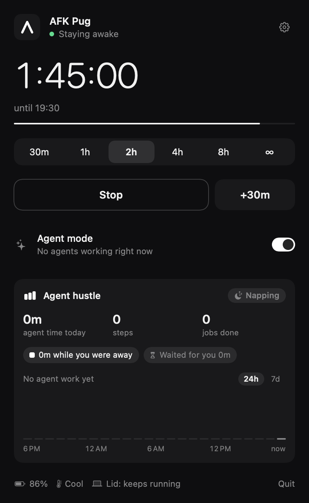</td>
<td valign="top">

**What it means:** you pressed **Go AFK**. The Mac stays awake until the timer ends, lid open or closed.

**What to do:** close the lid if you like. Press **+30m** for more time or **Stop** to end it. <kbd>⌥</kbd> <kbd>⌘</kbd> <kbd>A</kbd> starts or stops it from any app.

</td>
</tr>

<tr><td colspan="2"><h3>Agents working</h3></td></tr>
<tr>
<td valign="top">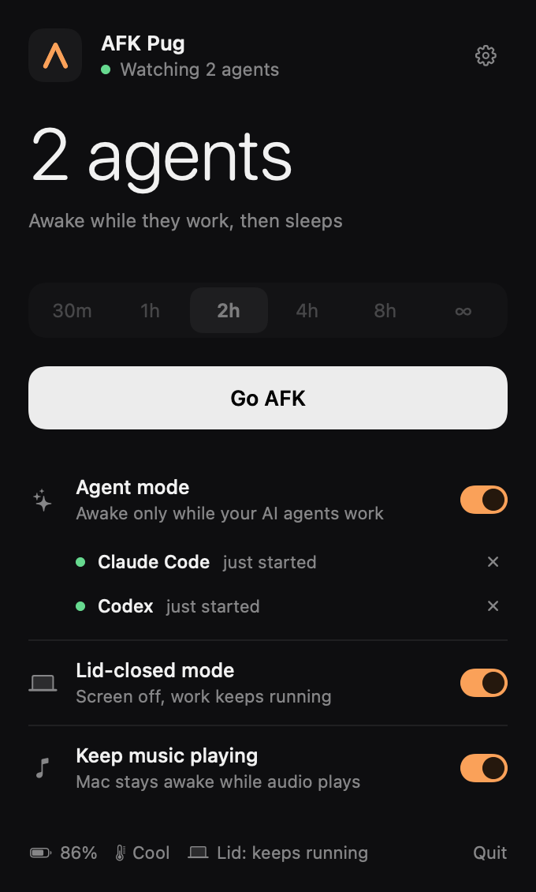</td>
<td valign="top">

**What it means:** each agent that's working has a green dot. An idle session waiting at the prompt doesn't count, and background tasks still running after a reply do.

**What to do:** close the lid and go. The **×** stops keeping the Mac awake for that one agent, without stopping the agent itself. An agent that's still running comes back on its next tool call. During one long command it doesn't, so the Mac can sleep mid-command.

</td>
</tr>

<tr><td colspan="2"><h3>Waiting for a usage limit</h3></td></tr>
<tr>
<td valign="top">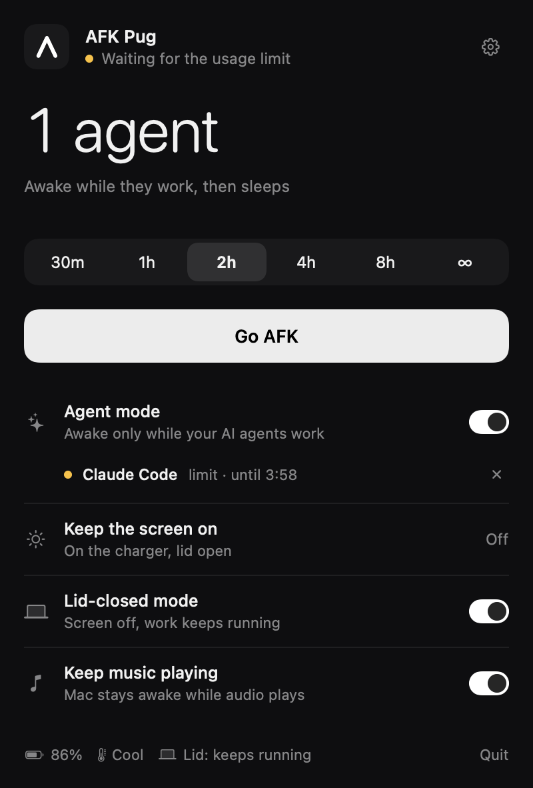</td>
<td valign="top">

**What it means:** Claude Code stopped on a claude.ai usage limit that resets within 6 hours. The amber dot shows the time. The Mac stays awake until shortly after the reset, so Claude can continue by itself.

**What to do:** nothing, or press **×** to let the Mac sleep. With no reset time in the error it waits 30 minutes. A weekly limit, a plain rate limit or any other API error lets the Mac sleep.

</td>
</tr>

<tr><td colspan="2"><h3>Agents done, waiting a moment</h3></td></tr>
<tr>
<td valign="top">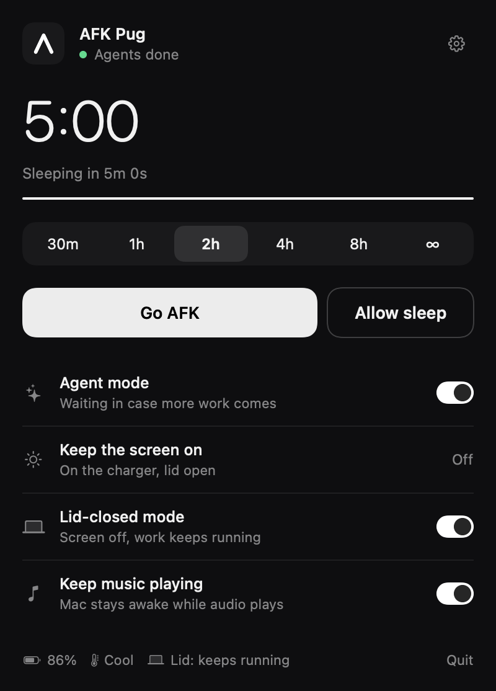</td>
<td valign="top">

**What it means:** the last agent finished, or you dismissed it with **×**, in which case the top line says *Stopped watching*. AFK Pug waits in case you send another prompt: 2 minutes by default, or off, 5 or 15 in Settings.

**What to do:** nothing. Press **Allow sleep** if you don't want to wait. It stops keeping the Mac awake, and macOS sleeps when it's ready.

</td>
</tr>

<tr><td colspan="2"><h3>Music playing</h3></td></tr>
<tr>
<td valign="top">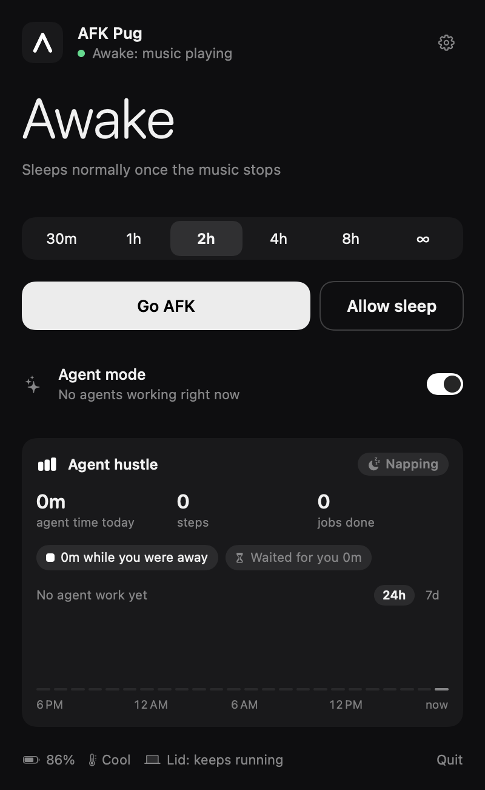</td>
<td valign="top">

**What it means:** YouTube, Spotify or Apple Music is playing, so the Mac stays awake with the sound on. Short gaps between tracks are ignored. With the lid closed, audio only counts if it was already playing when you closed it, so an idle browser tab can't keep a Mac in a bag awake.

**What to do:** nothing. **Allow sleep** stops keeping the Mac awake, so it sleeps when macOS decides, and music stays ignored until it stops and starts again.

</td>
</tr>

<tr><td colspan="2"><h3>Coming back</h3></td></tr>
<tr>
<td valign="top">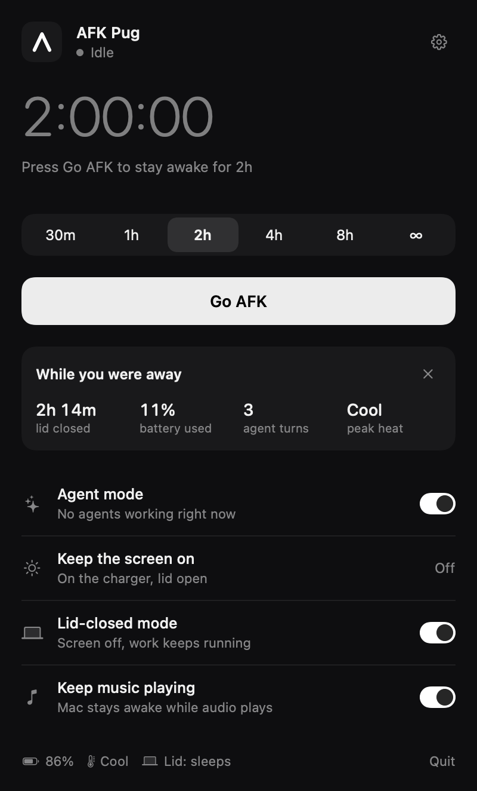</td>
<td valign="top">

**What it means:** you opened the lid. Screen, sound and Low Power Mode are back as they were, and the card shows how long the lid was closed, the battery used, agent turns finished and peak heat.

**What to do:** read it and press **×**.

</td>
</tr>

<tr><td colspan="2"><h3>Stopped by a safety guard</h3></td></tr>
<tr>
<td valign="top">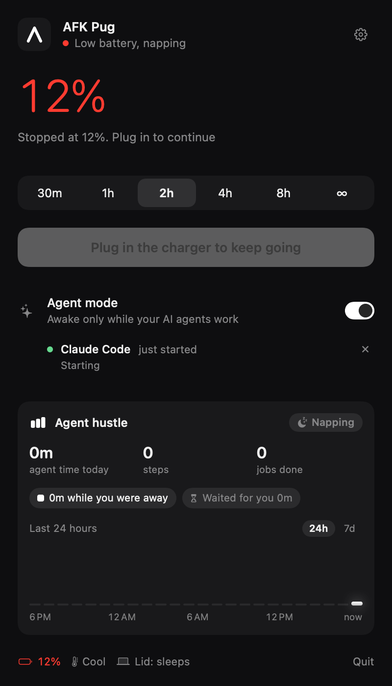</td>
<td valign="top">

**What it means:** the battery reached your floor (15% by default), or the Mac got critically hot. AFK Pug lets the Mac sleep to protect it, even with an agent still running.

**What to do:** plug in the charger, or let the Mac cool down. See [Safety](#safety).

</td>
</tr>
</table>

---

## Features

### Make it yours

Choose the look under **Settings → Appearance**. Click a swatch and it applies right away. **Background** can match your Mac, or be white, black, navy, forest, plum or any color you pick. **Accent color** sets the switches and the app mark, with six presets. The rainbow swatch opens a color pad and a hex field for anything else.

Text color follows the background and is raised until it's readable, so no combination can leave you with an unreadable app. Green, amber and red keep their meaning: working, waiting and warning. On macOS 26, cards use Liquid Glass.

<p align="center">
  
  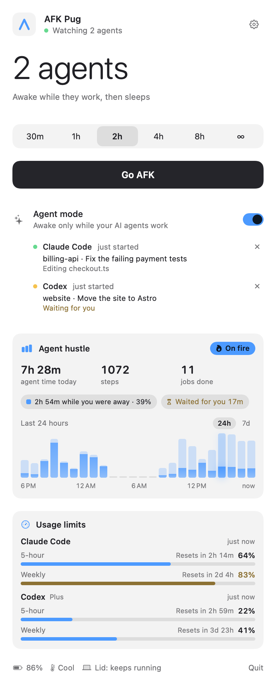
  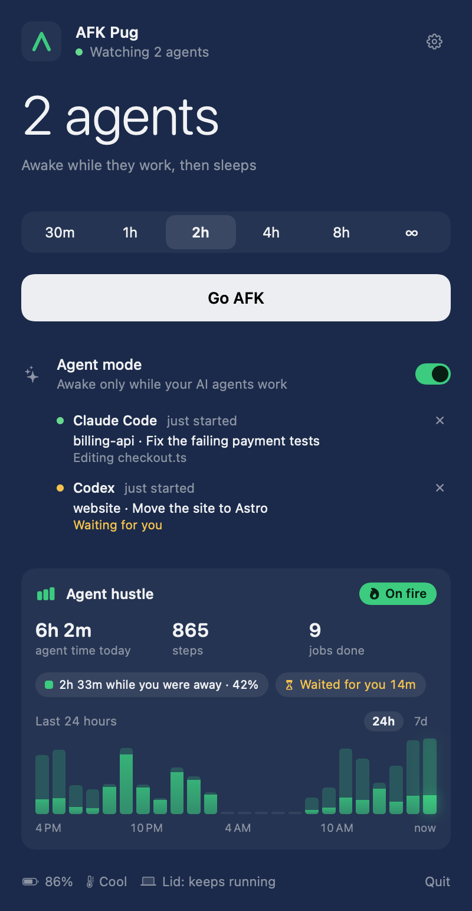
</p>

### When the lid closes

AFK Pug does this for you, and puts it all back when you open the lid:

| Action | Default | Why |
|---|---|---|
| Turn the built-in screen off | on | Apple Silicon can leave it lit under the lid, so it's repeated while the lid stays closed |
| Mute sound | on | skipped while music is playing |
| Low Power Mode on battery | on | also turns on if the Mac gets hot |
| Lock the screen | on | nobody can use your Mac while you're away |
| Pause chat apps | off | Slack, Discord, LINE and others. A chat app in a call is never paused |

### See it at a glance

Turn on **Settings → General → Show status in the menu bar** to see the time left (`1:45`) or how many agents are working (`2`) beside the A. It's off by default, because a MacBook with a notch has little room up there.

### Starts by itself

Both are off by default. Turn them on under **Settings → Start automatically**:

- **When the charger is connected**
- **While these apps are open:** names as shown in the Dock, such as `Xcode, Docker Desktop, OBS`

### Notifications on your Mac and phone

You're told when an agent finishes, needs a permission or hits an error. A "finished" notification only fires once the agent has really stopped. On battery, you also get a warning 5 points above your battery floor, before AFK Pug has to stop.

If an agent is waiting for your permission with the lid closed, the notification says the Mac sleeps in about 15 minutes unless the agent moves on. Phone messages are sent before the Mac goes to sleep.

For your phone, install the free [ntfy](https://ntfy.sh) app, subscribe to a topic name only you know, and enter the same name under **Settings → Phone notifications**. Press **Test** to check it.

### Works with your agents

| Agent | How AFK Pug knows it's working |
|---|---|
| Claude Code | Lifecycle hooks in `~/.claude/settings.json`, or the [plugin](#e-claude-code-plugin-optional). A hold with no activity for 15 minutes is dropped, unless Claude's process is still busy |
| Codex | Native hooks in `~/.codex/hooks.json`, after you trust them with `/hooks` |
| Gemini CLI | Native hooks in `~/.gemini/settings.json` |
| Cursor (app agent and `cursor-agent`) | Native hooks in `~/.cursor/hooks.json` (observational events only, so nothing you approve changes) |
| Aider, OpenCode, Amp, Goose, Qwen Code | Process detection (**Settings → Agents → Detect other agents**): counts as working while the process tree uses CPU |
| Anything else | The [`afkpug` command](#command-line) |

AFK Pug edits only its own entries, writes through symlinks, keeps your very first version of each file as `<file>.afkpug-backup`, and refuses read-only files.

### Command line

The CLI is installed at `~/.afkpug/bin/afkpug`. Add it to your PATH:

```sh
export PATH="$HOME/.afkpug/bin:$PATH"
```

```sh
afkpug run -- npm run build              # keep awake while a command runs (exit code and Ctrl-C pass through)
afkpug hold --for 1h30m --reason deploy  # 90s, 45m, 2h, 1h30m; a bare number means minutes; max 24h
afkpug release                           # drop CLI and agent-tool holds
afkpug status                            # is the app running, and every hold with time left
```

### URL commands

For Shortcuts, Raycast, Alfred or scripts:

```sh
open "afkpug://start?minutes=90"   # 0 = until you stop
open "afkpug://stop"
open "afkpug://toggle"
open "afkpug://sleep-now"           # same as Allow sleep
```

### Let the agent ask (MCP)

Under **Settings → Agents → Let agents keep the Mac awake**, AFK Pug registers an MCP server with Claude Code. It's useful when a build or deploy keeps running after the agent's reply. The [plugin](#e-claude-code-plugin-optional) includes this server.

| Tool | What it does |
|---|---|
| `keep_mac_awake` | Stay awake for 1–720 minutes, with a reason |
| `release_mac_awake` | Drop the holds this session created |
| `afk_status` | List what's keeping the Mac awake |

---

## Settings

Press the gear at the top right of the app.

| Section | Setting | Default |
|---|---|---|
| **When the lid closes** | Turn the screen off · Mute sound · Low Power Mode on battery · Lock the screen | on |
| | Pause chat apps | off |
| | Only when plugged in: on battery, closing the lid sleeps as usual | off |
| **Safety** | Stop at battery, from 5% to 50% | 15% |
| **Agents** | Notify me | on |
| | Wait before sleeping: off, 2, 5 or 15 minutes | 2 min |
| | Connect or disconnect Claude Code, Codex, Gemini CLI, Cursor | set by you |
| | Detect other agents | on |
| | Let agents keep the Mac awake (MCP) | not connected |
| **Phone notifications** | ntfy topic name | empty |
| **Start automatically** | When the charger is connected · While these apps are open | off |
| **Appearance** | Background: match Mac, white, black, three dark colors or custom | black |
| | Accent color: six presets or custom | orange |
| **General** | Open at login | on |
| | Show status in the menu bar | off |
| | Check for updates: once a day | on |
| | Show welcome again | |
| | <kbd>⌥</kbd> <kbd>⌘</kbd> <kbd>A</kbd> starts or stops AFK | on |
| | Language: Thai, English or match macOS | match macOS |
| **Activity** | What AFK Pug did recently | |
| **For developers** | Command line and URL commands | |

---

## Safety

A closed MacBook sheds heat more slowly, so AFK Pug has several guards:

- **Battery floor.** Warns 5 points early, then stops at 15% on battery (adjustable from 5% to 50%) and lets the Mac sleep.
- **Heat.** Turns on Low Power Mode when the Mac gets hot and always stops at critical temperature. This guard can't be turned off.
- **Crash-safe.** If the app quits or crashes, a launchd watchdog restores normal lid sleep within 30 seconds and resumes any paused apps. The next launch checks again.
- **Narrow permission.** The one-time setup adds a sudoers rule for exactly six commands: `pmset -a disablesleep 0|1`, and `pmset -b|-c lowpowermode 0|1` for the current power source only, so your own Low Power Mode settings are kept. Remove it any time from Settings.

> [!WARNING]
> Keep the Mac on a hard, ventilated surface. Don't put it in a bag while it's awake.

## Privacy

Everything stays on your Mac. There's no account and no telemetry. AFK Pug only goes online for two things: the optional phone notification, sent to the ntfy topic you enter, and the update check, which asks GitHub for the latest release once a day and sends nothing about you. Turn it off under **Settings → General → Check for updates**. Update files are checked against GitHub's checksum, this app's ID and version, and their code signature before they're installed.

---

## Troubleshooting

### The A icon is missing

On a MacBook with a notch, macOS hides menu bar icons when there isn't room, and doesn't tell you. Quit a few other menu bar apps, or hold <kbd>⌘</kbd> and drag other icons out of the bar. If AFK Pug isn't running at all, open it from Applications.

<details>
<summary><b>The Mac still sleeps when I close the lid</b></summary>
<br>

Open the app and check **Lid-closed mode**. If it says *Needs a one-time permission*, press **Set up**. Then check that something is keeping the Mac awake: an agent, a timer or music. With nothing to do, sleeping is correct. **Only when plugged in** also lets it sleep on battery.

</details>

<details>
<summary><b>I pressed Allow sleep and the Mac stayed awake</b></summary>
<br>

**Allow sleep** only stops AFK Pug keeping the Mac awake. macOS still sleeps on its own timer, and other apps can hold it awake. To see which ones, run `pmset -g assertions` in Terminal. To sleep right away, use the Apple menu or close the lid.

</details>

<details>
<summary><b>AFK Pug doesn't notice my agent</b></summary>
<br>

Check **Settings → Agents** and press **Connect**. For Codex, also open Codex and type `/hooks` to trust the hooks. Other agents need **Detect other agents** on, and only count while they use CPU.

</details>

<details>
<summary><b>It asks for the lid permission again after an update</b></summary>
<br>

Upgrading from 0.1 changed the permission rule, so press <b>Set up</b> once more. The rule still only permits the commands listed under <a href="#safety">Safety</a>.

</details>

<details>
<summary><b>Does the internet stay connected with the lid closed?</b></summary>
<br>

The Mac doesn't go to sleep, so Wi-Fi normally stays connected and downloads, SSH and syncs keep going. A weak connection, such as a phone hotspot, can still drop on its own.

</details>

<details>
<summary><b>How is this different from Amphetamine?</b></summary>
<br>

Amphetamine keeps the Mac awake for a set time. AFK Pug also turns the screen off and mutes sound when the lid closes, knows whether your agents are working, and lets the Mac sleep as soon as they're done.

</details>

<details>
<summary><b>What if I forget to turn it off?</b></summary>
<br>

Timers end on their own, agent mode ends when the work does, and quitting the app restores normal sleep. If the app crashes, the watchdog restores it within 30 seconds.

</details>

---

## Development

<details>
<summary><b>How it works</b></summary>
<br>

| Situation | Mechanism |
|---|---|
| Lid open | IOKit `PreventUserIdleSystemSleep` assertion, the same thing `caffeinate -i` uses |
| Lid closed | `pmset -a disablesleep 1`, re-checked every few seconds and always paired with `disablesleep 0` |
| Agent state | Hooks write small files to `~/.afkpug/holds` and `~/.afkpug/events`. The app polls every 2 seconds |
| Music | CoreAudio reports whether the default output device is in use |
| Screen off | `pmset displaysleepnow`, repeated while the lid stays closed |

`caffeinate` alone isn't enough: closing a MacBook lid triggers a separate sleep path that idle-sleep assertions don't block.

</details>

<details>
<summary><b>Build, test and render</b></summary>
<br>

A headless simulator drives the engine with fake lid, battery, heat, audio and process input. Nothing real runs: every power command is logged instead.

```sh
swift build && AFKPUG_SIM=1 AFKPUG_SIM_DIR=$(mktemp -d) "$(swift build --show-bin-path)/AFKPug" --simulate all      # 53 scenarios
swift build && AFKPUG_SIM=1 AFKPUG_SIM_DIR=$(mktemp -d) "$(swift build --show-bin-path)/AFKPug" --simulate stress   # 69 adversarial scenarios
scripts/screenshots.sh               # renders the app screens into docs/screens/
node scripts/guide-illustrations.mjs # draws the install pictures into docs/guide/
node scripts/demo-gif.mjs            # makes the demo animation (needs ffmpeg)
scripts/build.sh --zip               # packs dist/AFK-Pug.zip for a GitHub release
```

Run `swift build` first: `--show-bin-path` only prints the folder, it doesn't build.

</details>

<details>
<summary><b>Project layout</b></summary>
<br>

```
Sources/AFKPug/
├── App.swift           entry point, menu bar, URL commands, --mcp / --simulate / render modes
├── Engine.swift        session logic: timers, agents, guards, lid actions
├── PowerControl.swift  pmset, IOKit assertions, one-time setup
├── Sensors.swift       lid, battery and thermal state
├── Agents.swift        holds, events, Claude Code hooks, watchdog, uninstaller
├── Integrations.swift  Codex, Gemini CLI and Cursor hooks, careful config file editing
├── Updater.swift       checks for, verifies and installs new versions
├── Extras.swift        process detection, chat pause, lock, hotkey, ntfy, MCP, audio
├── Scripts.swift       hook, CLI and watchdog shell scripts
├── Views.swift         home screen
├── Theme.swift         background and accent colors, legible text
├── Settings.swift      settings screen and shared controls
├── Onboarding.swift    first-run welcome window
├── Brand.swift         app mark and app icon
├── L10n.swift          Thai and English strings
├── Screens.swift       README screenshots from fake sensors
└── Simulation.swift    headless test scenarios
```

</details>

### Roadmap

- [ ] Signed and notarized download, Homebrew cask (needs an Apple Developer ID)
- [ ] Privileged helper (SMAppService) instead of a sudoers rule (needs signing)
- [ ] PushPug integration

## Credits

Made by [Pug-03](https://github.com/Pug-03), who also made [PushPug](https://github.com/Pug-03/PushPug). [MIT License](LICENSE) · [Changelog](CHANGELOG.md)
