<p align="center">
  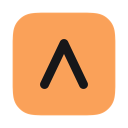
</p>

<h1 align="center">AFK Pug</h1>

<p align="center">
  <b>พับจอได้ งานไม่หยุด AFK Pug เฝ้าให้</b>
</p>

<p align="center">
  <a href="https://github.com/Pug-03/AFK_Pug/releases/latest"></a>
</p>

<p align="center">
  <a href="https://github.com/Pug-03/AFK_Pug/actions/workflows/ci.yml"></a>
  
  
  
  
</p>

<p align="center">
  <a href="#what">ทำอะไรได้</a> ·
  <a href="#install">วิธีติดตั้ง</a> ·
  <a href="#screens">หน้าจอแต่ละแบบ</a> ·
  <a href="#features">ฟีเจอร์</a> ·
  <a href="#settings">ตั้งค่า</a> ·
  <a href="#safety">ความปลอดภัย</a> ·
  <a href="#help">แก้ปัญหา</a> ·
  <a href="README.md">English</a>
</p>

<p align="center">
  <a href="docs/demo-th.mp4">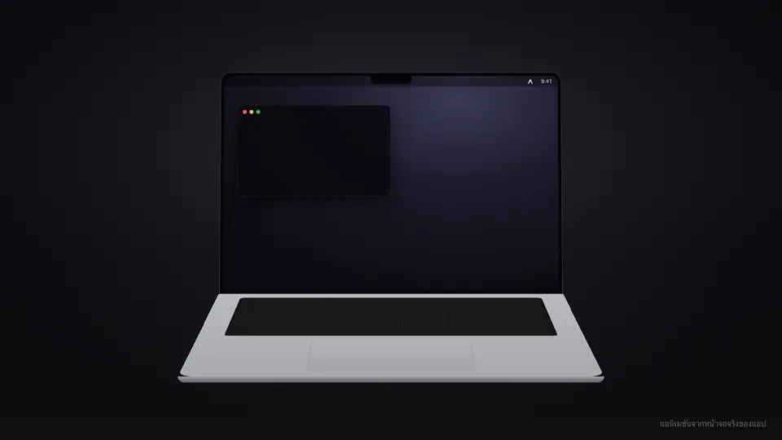</a>
  <br>
  <sub>ทำจากหน้าจอจริงของแอป · <a href="docs/demo-th.mp4">ดูวิดีโอแบบคมชัด</a></sub>
</p>

---

<a id="what"></a>

## ทำอะไรได้

สั่ง Claude Code ให้ทำงาน แล้วพับจอเดินไปกินข้าว กลับมาพบว่างานไม่ขยับเลย เพราะ Mac พักเครื่องทันทีที่พับจอ

**AFK Pug คือแอปเล็กๆ บน menu bar ที่ทำให้ MacBook ทำงานต่อได้หลังพับจอ** ไม่ต้องต่อจอนอก ใช้ได้ทั้งตอนใช้แบตและเสียบสายชาร์จ แอปรู้ว่า AI agent ทำงานอยู่จริงไหม ปิดหน้าจอเพื่อประหยัดแบต และปล่อยให้เครื่องพักทันทีที่งานเสร็จ

<p align="center">
  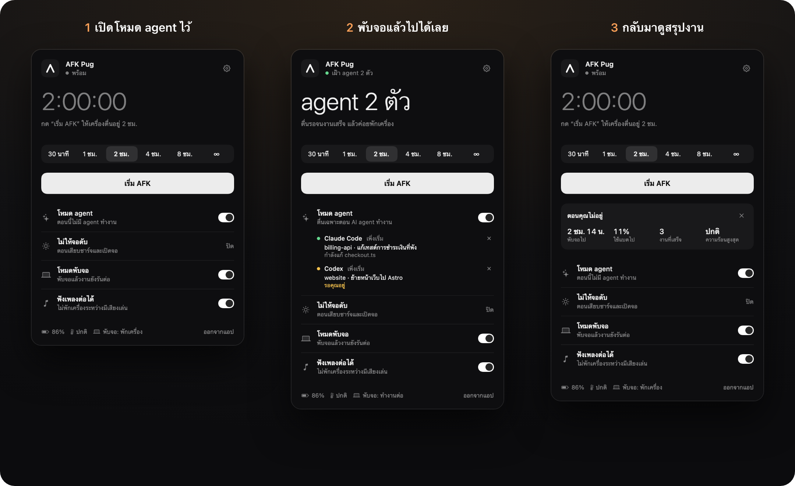
</p>

- **ทำงานได้แม้พับจอ:** ไม่ต้องใช้จอนอกหรืออุปกรณ์เสริม
- **บอกได้ว่า agent ทำอะไรอยู่:** โปรเจกต์ ข้อความที่สั่ง ขั้นตอนปัจจุบัน และงานไหนเสร็จแล้ว
- **ไม่ให้จอดับได้:** ตอน agent ทำงาน หรือต่ออีก 30 นาทีถึง 1 ชั่วโมง
- **ดูได้ว่า agent ขยันแค่ไหน:** เวลาทำงาน จำนวนขั้นตอน และงานที่เสร็จ เป็นกราฟ 24 ชั่วโมงหรือ 7 วันล่าสุด
- **ตื่นตาม agent:** Claude Code, Codex, Gemini CLI, Cursor และอื่นๆ
- **รอโควตา Claude รีเซ็ต:** เครื่องตื่นรอจนถึงเวลารีเซ็ต เพื่อให้งานทำต่อได้
- **ประหยัดแบต:** ปิดหน้าจอ ปิดเสียง เปิดโหมดพลังงานต่ำ แล้วคืนค่าเดิมเมื่อเปิดจอ
- **ฟังเพลงต่อได้:** เพลงที่เปิดอยู่ก่อนพับจอจะเล่นต่อ
- **มีขีดจำกัดที่ชัดเจน:** หยุดเมื่อแบตต่ำหรือเครื่องร้อนจัด และคืนการพักเครื่องปกติแม้แอปแครช
- **ปรับหน้าตาได้:** ขาวดำเป็นค่าเริ่มต้น หรือเลือกพื้นหลังและสีหลักเองได้
- **ข้อมูลอยู่ในเครื่อง:** ไม่ต้องมีบัญชี และไม่เก็บข้อมูลการใช้งาน

### มีอะไรใหม่ใน 0.7

- **ความขยันของ agent:** กราฟบนหน้าหลัก บอกว่า agent ทำงานไปนานแค่ไหน กี่ขั้นตอน เสร็จกี่งาน ดูได้ทั้ง 24 ชั่วโมงและ 7 วันล่าสุด พร้อมป้ายระดับตั้งแต่ **หลับอยู่** ไปจนถึง **ไฟลุก**
- **หน้าหลักโล่งขึ้น:** **โหมดพับจอ**, **ไม่ให้จอดับ** และ **ฟังเพลงต่อได้** ย้ายไปอยู่ที่ **ตั้งค่า → ให้เครื่องตื่น**
- **เปิดมาเจอหน้าหลักเสมอ:** แม้ปิดแผงไว้ตอนอยู่หน้าตั้งค่า

### มีอะไรใหม่ใน 0.6

- **ดูได้ว่า agent ทำอะไรอยู่:** โปรเจกต์ ข้อความที่สั่ง ขั้นตอนปัจจุบัน และรายการ **เพิ่งเสร็จ**
- **กดที่ agent เพื่อไปหามันได้เลย:** เด้งไปแท็บ terminal หรือหน้าต่างโปรเจกต์ของงานนั้น
- **ไม่ให้จอดับ:** ตอน agent ทำงาน หรือต่ออีก 30 นาทีถึง 1 ชั่วโมง
- **หน้าแนะนำแบบทีละขั้น:** เลือกภาษา แล้วสอนใช้งานทีละส่วน
- **อัปเดตในแอป:** เช็กวันละครั้ง กดปุ่มเดียวติดตั้งได้ และปิดการเช็กได้
- **สถานะบน menu bar:** แสดงเวลาที่เหลือหรือจำนวน agent ข้างตัว A ได้ถ้าต้องการ
- **เตือนแบตก่อนถึงจุดหยุด:** เตือนก่อน 5% และการแจ้งเตือนถึงมือถือจะส่งออกก่อนเครื่องพัก
- **ใช้แล้วลื่นขึ้น:** แผงกว้างขึ้นและกางออกตอนเปิด เปลี่ยนหน้าและเลื่อนได้นิ่งขึ้น

ถ้าใช้ 0.5.0 อยู่ ให้ดาวน์โหลด zip ใหม่หนึ่งครั้ง หลังจากนั้นแอปจะอัปเดตเองได้ ดูรายการทั้งหมดที่ [CHANGELOG](CHANGELOG.md)

---

<a id="install"></a>

## วิธีติดตั้ง

คนส่วนใหญ่ทำแค่ **ก่อนเริ่ม**, **A** และ **C** ใช้เวลาราว 2 นาที

| ส่วน | เนื้อหา | ใครต้องทำ |
|---|---|---|
| [ก่อนเริ่ม](#before) | เช็ก Mac และเวอร์ชัน macOS | ทุกคน |
| [A. ดาวน์โหลดแอป](#a) | ดาวน์โหลด ย้ายไป Applications เปิดครั้งแรก | ทุกคน |
| [B. Build เอง](#b) | จากซอร์สโค้ด | นักพัฒนา |
| [C. หน้าต่างแนะนำ](#c) | ให้สิทธิ์และเชื่อมต่อ agent | ทุกคน |
| [D. หาไอคอนบน menu bar](#d) | แอปอยู่ตรงไหน | ทุกคน |
| [E. ปลั๊กอิน Claude Code](#e) | ใช้ hook โดยไม่ต้องแก้ไฟล์ตั้งค่า | ไม่บังคับ |
| [อัปเดตหรือถอนการติดตั้ง](#update) | เวอร์ชันใหม่ และการลบแอป | ภายหลัง |

<a id="before"></a>

### ก่อนเริ่ม

เปิดเมนู Apple แล้วเลือก **เกี่ยวกับ Mac เครื่องนี้** (About This Mac) ต้องเป็น:

- **ชิป:** Apple M1 ขึ้นไป ไม่รองรับ Mac ชิป Intel
- **macOS:** 14 Sonoma ขึ้นไป

ถ้าใช้ Amphetamine หรือแอปคล้ายกัน ให้ปิดก่อน เพื่อไม่ให้สองแอปแย่งกันคุมการพักเครื่อง

<a id="a"></a>

### A. ดาวน์โหลดแอป

**A1. ดาวน์โหลด** เปิด[รุ่นล่าสุด](https://github.com/Pug-03/AFK_Pug/releases/latest) เลื่อนลงไปที่ **Assets** แล้วกด **`AFK-Pug.zip`** **(1)**

<p align="center">
  <picture>
    <source media="(prefers-color-scheme: dark)" srcset="docs/guide/download-dark.png">
    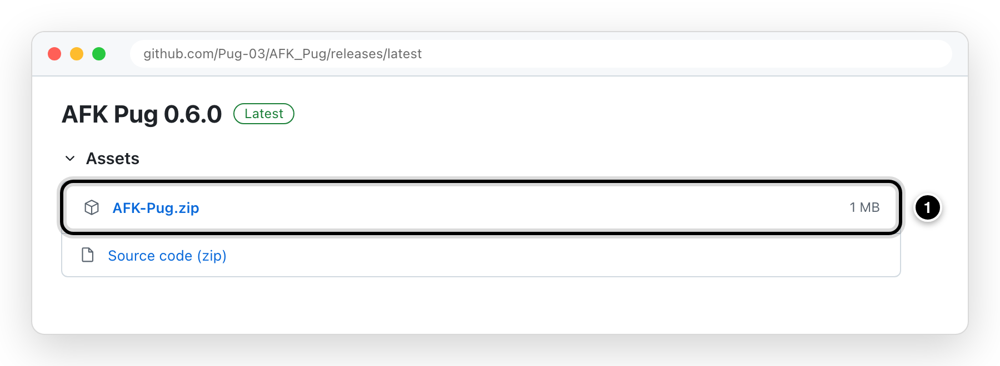
  </picture>
</p>

**A2. ย้ายไป Applications** เปิดโฟลเดอร์ **Downloads** ถ้าไฟล์ zip ยังไม่แตกให้ดับเบิลคลิก แล้วลาก **AFK Pug** ไปไว้ใน **Applications** **(2)** ต้องอยู่ในโฟลเดอร์นี้เท่านั้น เพราะ hook ของ agent และปลั๊กอิน Claude Code จะหาแอปที่นี่

<p align="center">
  <picture>
    <source media="(prefers-color-scheme: dark)" srcset="docs/guide/drag-dark.png">
    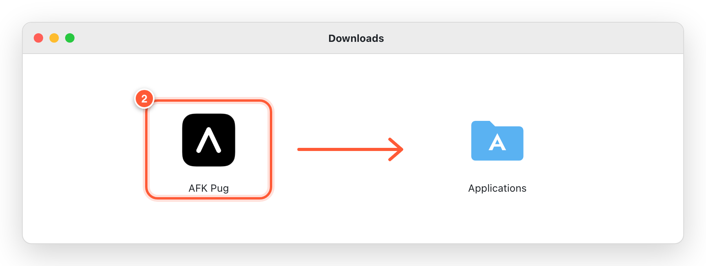
  </picture>
</p>

**A3. เปิดครั้งแรก** ดับเบิลคลิก AFK Pug ใน Applications แล้ว macOS จะบล็อกไว้ เพราะแอปยังไม่ได้เซ็นด้วย Apple Developer ID แบบเสียเงิน ให้กด **Done** **(3)** อย่ากด *Move to Trash*

<p align="center">
  <picture>
    <source media="(prefers-color-scheme: dark)" srcset="docs/guide/blocked-dark.png">
    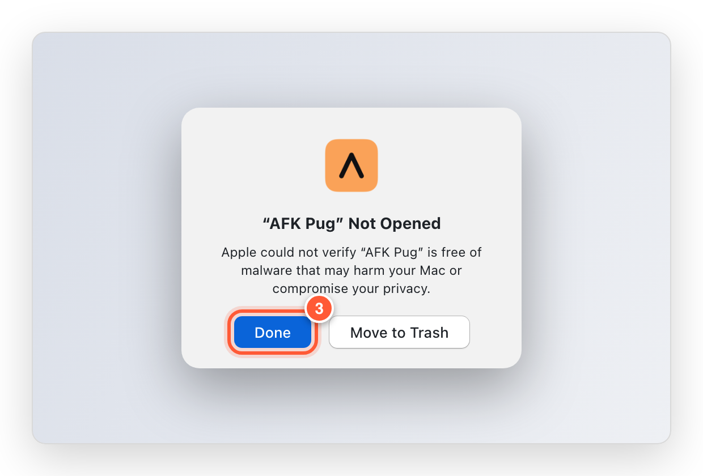
  </picture>
</p>

**A4. อนุญาตให้เปิด** ไปที่ **System Settings → Privacy & Security** **(4)** เลื่อนลงไปส่วน **Security** แล้วกด **Open Anyway** **(5)** ยืนยันด้วยรหัสผ่านหรือ Touch ID แล้วกด **Open Anyway** อีกครั้ง ทำแค่ครั้งเดียว

<p align="center">
  <picture>
    <source media="(prefers-color-scheme: dark)" srcset="docs/guide/anyway-dark.png">
    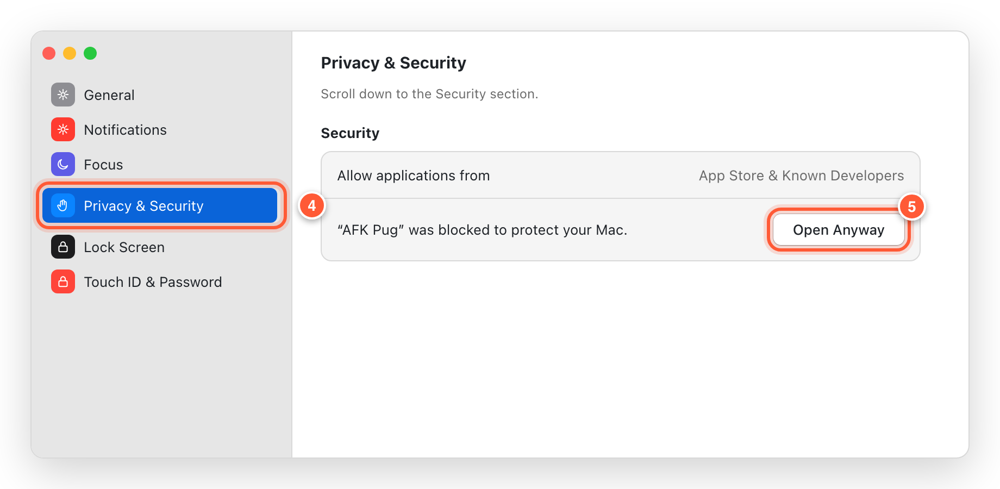
  </picture>
</p>

ถ้า macOS เป็นภาษาไทย ชื่อเมนูและปุ่มจะเป็นภาษาไทย แต่อยู่ตำแหน่งเดียวกับในรูป

จากนั้นหน้าต่างแนะนำจะเปิดขึ้นมา ไปต่อที่ [C. หน้าต่างแนะนำ](#c)

<details>
<summary><b>ใช้ macOS 14 Sonoma หรือไม่เห็นปุ่ม Open Anyway?</b></summary>
<br>

บน macOS 14 ข้อความในหน้าต่างจะต่างออกไป แต่ปุ่มใน **Privacy & Security** ใช้ได้เหมือนกัน หรือจะกด Control ค้างแล้วคลิกแอปใน Applications เลือก **Open** แล้วกด **Open** อีกครั้งก็ได้

ปุ่ม Open Anyway จะแสดงราว 1 ชั่วโมงหลังถูกบล็อก ถ้าไม่เห็นให้ลองเปิดแอปอีกครั้ง ถ้าเชื่อถือไฟล์ที่ดาวน์โหลดมานี้และยังไม่เห็นปุ่ม ให้รันคำสั่งนี้ใน Terminal:

```sh
xattr -dr com.apple.quarantine "/Applications/AFK Pug.app"
```

</details>

<a id="b"></a>

### B. Build เอง

ต้องมี Xcode 16 ขึ้นไป หรือ command line tools จาก `xcode-select --install` เช็กด้วย `swift --version`

```sh
git clone https://github.com/Pug-03/AFK_Pug.git
cd AFK_Pug
scripts/build.sh --install   # build, คัดลอกไป /Applications แล้วเปิดแอป
```

ไม่ต้องทำ A3 และ A4 เพราะ macOS บล็อกเฉพาะแอปที่ดาวน์โหลดมา

<a id="c"></a>

### C. หน้าต่างแนะนำ

หน้าต่างแนะนำจะเปิดเองเมื่อเปิดแอปครั้งแรก และสอนใช้งานทีละส่วน ข้ามขั้นไหนก็ได้ เปิดดูอีกครั้งได้ที่ **ตั้งค่า → ทั่วไป → ดูหน้าแนะนำอีกครั้ง**

| ขั้น | ต้องทำอะไร |
|---|---|
| **1. เลือกภาษา** | English หรือไทย |
| **2. รู้จัก AFK Pug** | หาตัว A บน menu bar |
| **3. โหมดพับจอ** | กด **อนุญาต** แล้วใส่รหัสผ่าน ถามครั้งเดียว และอนุญาตเฉพาะ[คำสั่งเหล่านี้](#safety) |
| **4. เชื่อมต่อ agent** | กด **เชื่อมต่อ** ที่ agent ที่ใช้ ปุ่มจะแสดงเฉพาะ agent ที่ติดตั้งไว้ |
| **5–9. แนะนำการใช้งาน** | ดูว่า agent ทำอะไรอยู่, ตั้งเวลา, พับจอ, ไม่ให้จอดับ และปรับสี |
| **10. พร้อมแล้ว** | เปิด **โหมด agent** และ **เปิดเองตอนเปิดเครื่อง** ไว้ แล้วกด **เสร็จแล้ว** |

<p align="center">
  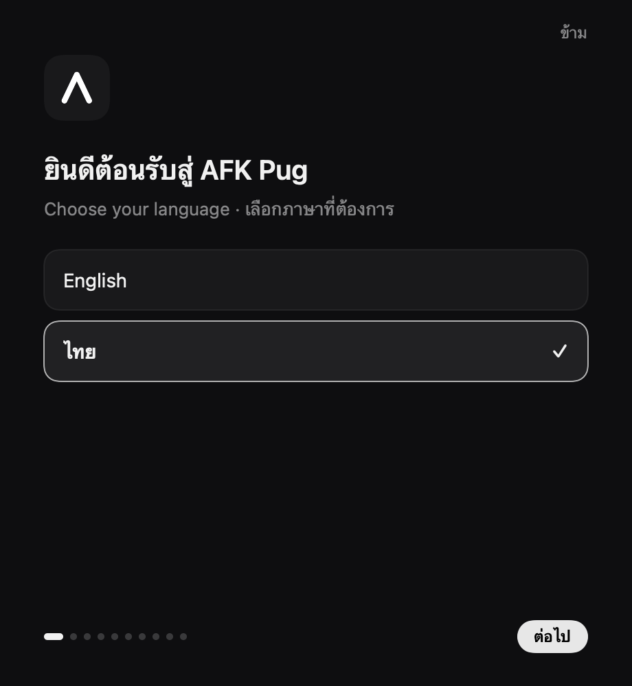
  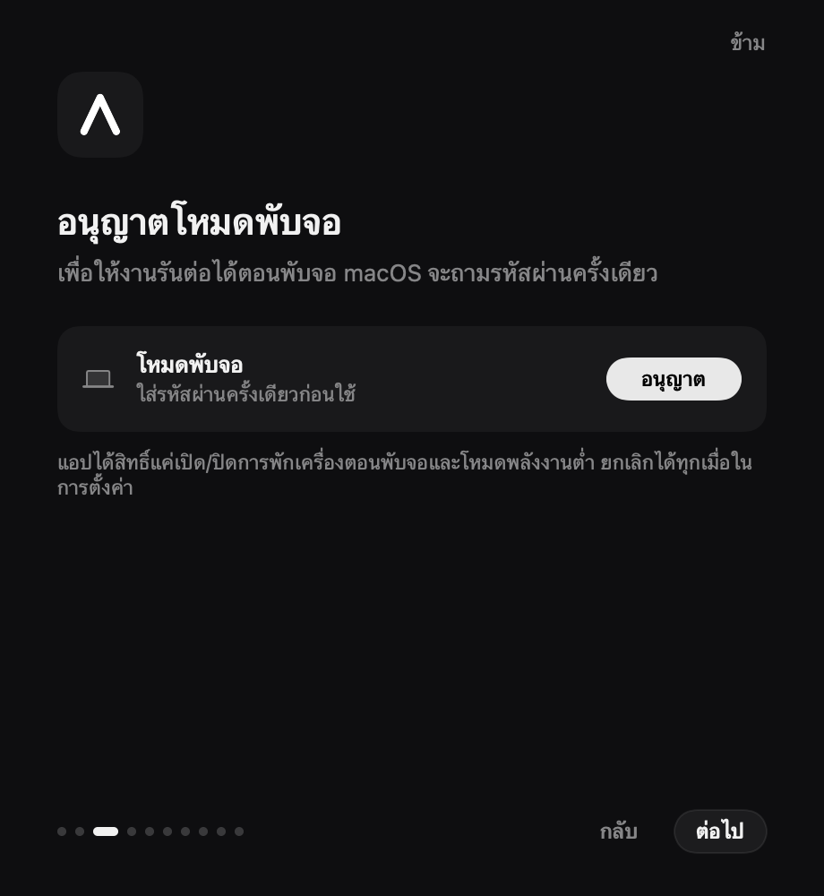
  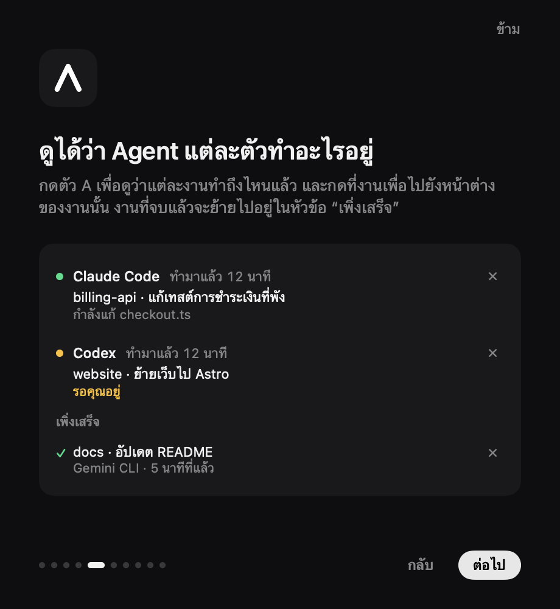
</p>

> **ผู้ใช้ Codex:** Codex จะรัน hook ใหม่หลังจากที่คุณเชื่อถือแล้วเท่านั้น ให้เปิด Codex แล้วพิมพ์ `/hooks` ระหว่างนั้น AFK Pug จะตรวจจับ Codex จาก process ที่รันอยู่

**ลองใช้:** สั่งงาน agent แล้วพับจอ แค่นั้นเอง

<a id="d"></a>

### D. หาไอคอนบน menu bar

AFK Pug ไม่มีไอคอนใน Dock แต่อยู่บน menu bar มุมขวาบนของจอ เป็นตัว **A** **(1)** คลิกเพื่อเปิดแอป ระหว่างที่แอปทำให้เครื่องตื่นอยู่ ตัว A จะมีขีดกลางเพิ่มขึ้นมา

<p align="center">
  <picture>
    <source media="(prefers-color-scheme: dark)" srcset="docs/guide/menubar-dark.png">
    
  </picture>
</p>

ถ้าไม่เห็น ดูที่[ไม่เห็นไอคอน A](#missing-icon)

<a id="e"></a>

### E. ปลั๊กอิน Claude Code (ไม่บังคับ)

แทนที่จะให้แอปแก้ `~/.claude/settings.json` จะติดตั้ง hook และ MCP server เป็นปลั๊กอินของ Claude Code ก็ได้ ติดตั้งแอปใน `/Applications` ก่อน แล้วพิมพ์ใน Claude Code:

```
/plugin marketplace add Pug-03/AFK_Pug
/plugin install afk-pug@afk-pug
```

ลบด้วย `/plugin uninstall afk-pug` เมื่อติดตั้งปลั๊กอินแล้ว หน้าตั้งค่าจะแสดงว่า Claude Code เชื่อมต่อแล้ว และแถว MCP มาจากปลั๊กอิน

<a id="update"></a>

### อัปเดตหรือถอนการติดตั้ง

**อัปเดต:**

| ติดตั้งด้วยวิธี | วิธีอัปเดต |
|---|---|
| **ดาวน์โหลด** (A) | แอปจะเช็กวันละครั้ง และขึ้นการ์ดเมื่อมีเวอร์ชันใหม่ กด **อัปเดต** แอปจะดาวน์โหลด ตรวจไฟล์ ปิด แล้วเปิดใหม่เอง การตั้งค่ายังอยู่ครบ ถ้าอยากเช็กทันที ไปที่ **ตั้งค่า → ทั่วไป → เช็กเลย** |
| **Build เอง** (B) | ในโฟลเดอร์ `AFK_Pug` รัน `git pull` แล้วตามด้วย `scripts/build.sh --install` |

ถ้าใช้ 0.5.0 หรือเก่ากว่า หรือแอปไม่ได้อยู่ใน Applications ให้ดาวน์โหลด zip ใหม่จาก[หน้า Releases](https://github.com/Pug-03/AFK_Pug/releases/latest) แล้วแทนที่แอปเอง

**ถอนการติดตั้ง:** **ตั้งค่า → ถอนการติดตั้ง AFK Pug…** จะลบ hook ของ agent ทั้ง 4 ตัว, MCP, watchdog, การเปิดเองตอนเปิดเครื่อง, สิทธิ์โหมดพับจอ และ `~/.afkpug` คืนการพักเครื่องปกติ แล้วปิดแอป จากนั้นลบแอปออกจาก Applications

ไฟล์ตั้งค่าเดิมของคุณจะเก็บไว้เป็น `<file>.afkpug-backup` เช่น `~/.claude/settings.json.afkpug-backup` ส่วนปลั๊กอิน Claude Code ต้องลบแยกด้วย `/plugin uninstall afk-pug`

---

<a id="screens"></a>

## หน้าจอแต่ละแบบ และต้องทำอะไร

คลิก A บน menu bar บรรทัดใหญ่ด้านบนจะบอกเสมอว่าทำไมเครื่องถึงตื่นอยู่ หรือบอกว่าไม่ได้ตื่นอยู่

<table>
<tr><td colspan="2"><h3>พร้อม</h3></td></tr>
<tr>
<td width="250" valign="top">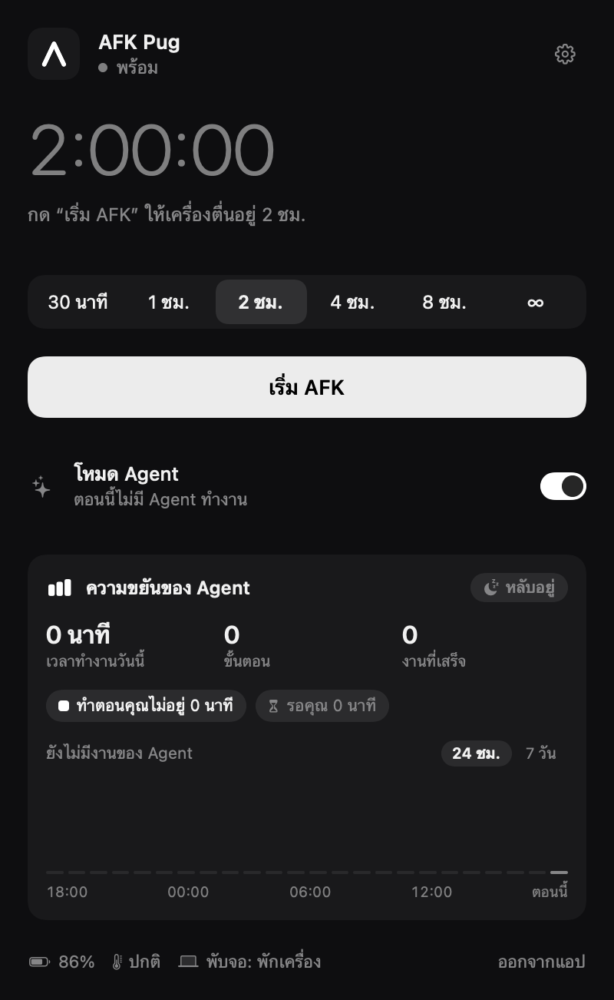</td>
<td valign="top">

**หมายความว่า:** ไม่มีอะไรทำให้เครื่องตื่น เครื่องจึงพักตามปกติ ถ้าเปิด **โหมด agent** ไว้ แอปจะเริ่มเองเมื่อ agent ทำงาน

**ต้องทำ:** ไม่ต้องทำอะไร ถ้าอยากให้เครื่องตื่นโดยไม่มี agent ให้เลือกเวลาแล้วกด **เริ่ม AFK**

</td>
</tr>

<tr><td colspan="2"><h3>ยังตั้งค่าไม่ครบ</h3></td></tr>
<tr>
<td valign="top">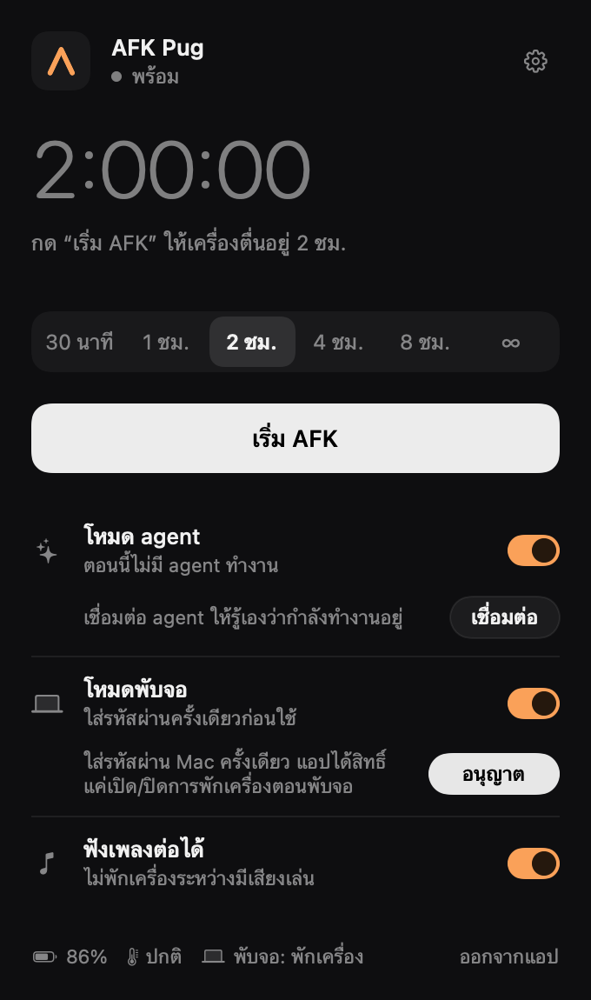</td>
<td valign="top">

**หมายความว่า:** คุณข้ามบางขั้นในหน้าต่างแนะนำ ถ้ายังไม่ให้สิทธิ์ เครื่องจะพักเมื่อพับจอ ถ้ายังไม่เชื่อมต่อ แอปจะหา agent ได้จาก process เท่านั้น

**ต้องทำ:** กด **เชื่อมต่อ** สำหรับ agent ส่วนโหมดพับจอ เข้า **ตั้งค่า → ให้เครื่องตื่น** แล้วกด **อนุญาต** ที่แถว **โหมดพับจอ**

</td>
</tr>

<tr><td colspan="2"><h3>กำลังนับเวลา</h3></td></tr>
<tr>
<td valign="top">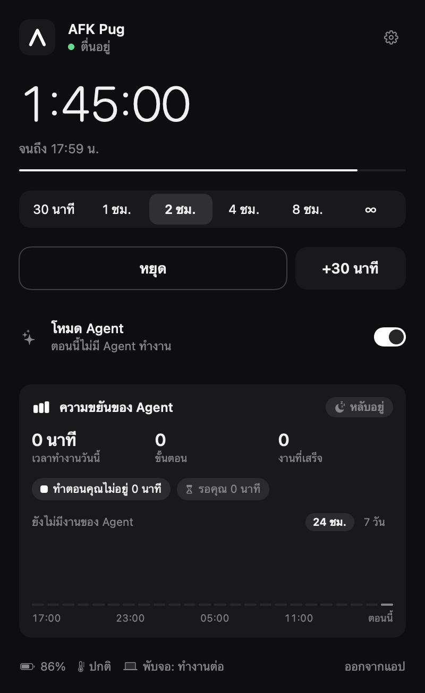</td>
<td valign="top">

**หมายความว่า:** คุณกด **เริ่ม AFK** แล้ว เครื่องจะตื่นจนหมดเวลา ทั้งตอนเปิดจอและพับจอ

**ต้องทำ:** พับจอได้เลย กด **+30 นาที** เพื่อต่อเวลา หรือ **หยุด** เพื่อจบ คีย์ลัด <kbd>⌥</kbd> <kbd>⌘</kbd> <kbd>A</kbd> เริ่มหรือหยุดได้จากทุกแอป

</td>
</tr>

<tr><td colspan="2"><h3>agent กำลังทำงาน</h3></td></tr>
<tr>
<td valign="top">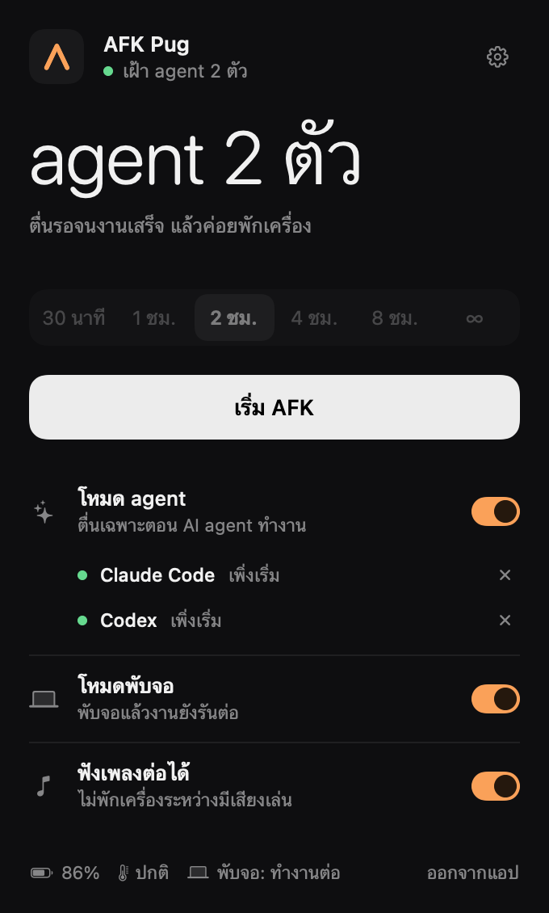</td>
<td valign="top">

**หมายความว่า:** แต่ละแถวบอกโปรเจกต์ ข้อความที่คุณสั่ง และขั้นตอนปัจจุบัน เช่น *กำลังแก้ checkout.ts* ถ้าจุดเป็นสีเหลืองและขึ้น *รอคุณอยู่* แปลว่า agent รอให้กดอนุญาต agent ที่ทำงานอยู่จะมีจุดสีเขียว session ที่เปิดรอเฉยๆ ไม่นับ แต่งาน background ที่ยังรันหลัง agent ตอบแล้วจะนับ

เมื่องานจบ จะย้ายไปที่ **เพิ่งเสร็จ** พร้อมโปรเจกต์ งาน และเวลา จึงเห็นได้ทันทีว่าอะไรเสร็จแล้ว ส่วน agent ที่ตรวจเจอจาก process จะแสดงแค่ชื่อ

**ไปยัง agent:** กดที่แถวของมัน หรือแถวใน **เพิ่งเสร็จ** เพื่อเปิดหน้าต่างของงานนั้นขึ้นมา

| รันอยู่ใน | กดแล้วไปที่ |
|---|---|
| Terminal, iTerm2 | ตรงแท็บเลย macOS จะขออนุญาตหนึ่งครั้ง ถ้าไม่อนุญาตจะเปิดแค่แอป |
| VS Code, Cursor, Windsurf | หน้าต่างของโปรเจกต์ แต่ไม่ถึงแท็บ terminal ข้างใน ถ้าโปรเจกต์ไม่ได้เปิดอยู่จะเปิดแค่แอป |
| tmux | pane นั้น แล้วเปิด terminal ที่ครอบอยู่ |
| แอปอื่น | เปิดแอปนั้น |

AFK Pug จะไม่เปิดแอปที่ยังไม่ได้รันอยู่ ส่วน agent ที่ตรวจเจอจาก process ไม่รู้ว่าอยู่หน้าต่างไหน จึงกดไม่ได้

**ต้องทำ:** พับจอแล้วไปได้เลย ปุ่ม **×** เลิกให้เครื่องตื่นเพื่อ agent ตัวนั้น แต่ไม่ได้หยุด agent ถ้า agent ยังรันอยู่ จะกลับมาเองเมื่อเริ่มใช้เครื่องมือครั้งถัดไป แต่ระหว่างคำสั่งยาวๆ จะไม่กลับมา เครื่องจึงอาจพักกลางคำสั่งได้

</td>
</tr>

<tr><td colspan="2"><h3>รอโควตารีเซ็ต</h3></td></tr>
<tr>
<td valign="top">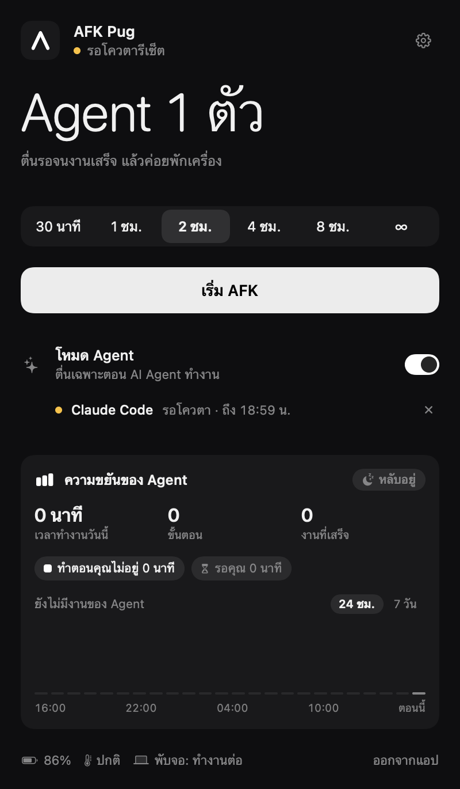</td>
<td valign="top">

**หมายความว่า:** Claude Code หยุดเพราะโควตา claude.ai หมด และจะรีเซ็ตภายใน 6 ชม. จุดสีเหลืองอำพันแสดงเวลา เครื่องจะตื่นจนเลยเวลารีเซ็ตไปเล็กน้อย เพื่อให้ Claude ทำงานต่อเองได้

**ต้องทำ:** ไม่ต้องทำอะไร หรือกด **×** เพื่อให้เครื่องพัก ถ้า error ไม่บอกเวลารีเซ็ต แอปจะรอ 30 นาที ส่วนโควตารายสัปดาห์ rate limit ทั่วไป และ API error อื่นๆ เครื่องจะพักตามปกติ

</td>
</tr>

<tr><td colspan="2"><h3>agent เสร็จแล้ว รออีกสักครู่</h3></td></tr>
<tr>
<td valign="top">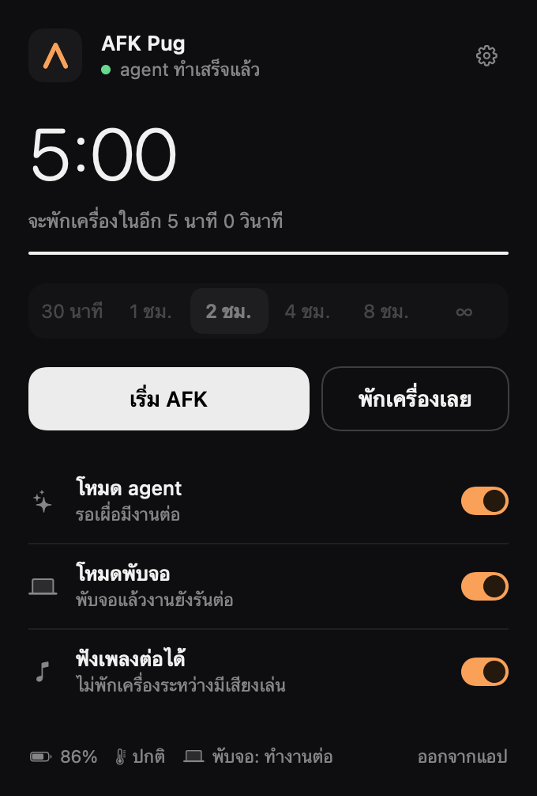</td>
<td valign="top">

**หมายความว่า:** agent ตัวสุดท้ายเสร็จแล้ว หรือคุณกด **×** ซึ่งบรรทัดบนจะขึ้นว่า *เลิกเฝ้าแล้ว* แอปรอเผื่อคุณสั่งงานต่อ ค่าเริ่มต้น 2 นาที เปลี่ยนเป็นปิด, 5 หรือ 15 นาทีได้ในหน้าตั้งค่า

**ต้องทำ:** ไม่ต้องทำอะไร ถ้าไม่อยากรอให้กด **ให้พักได้เลย** แอปจะเลิกกันเครื่องหลับ แล้ว macOS จะพักเครื่องเมื่อถึงเวลา

</td>
</tr>

<tr><td colspan="2"><h3>กำลังเล่นเพลง</h3></td></tr>
<tr>
<td valign="top">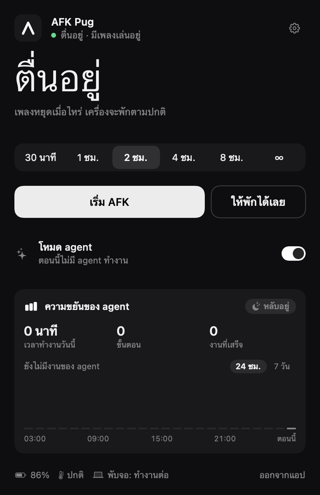</td>
<td valign="top">

**หมายความว่า:** คุณพับจอตอนที่ YouTube, Spotify หรือ Apple Music กำลังเล่น เครื่องจึงตื่นและเพลงเล่นต่อ ช่วงเงียบสั้นๆ ระหว่างเพลงไม่นับ แอปนับเฉพาะเสียงที่เล่นอยู่ก่อนพับ แท็บเบราว์เซอร์ที่ค้างอยู่จึงทำให้ Mac ในกระเป๋าตื่นไม่ได้ ตอนเปิดจออยู่แอปจะไม่ยุ่ง เพราะ macOS ไม่พักเครื่องระหว่างมีเสียงเล่นอยู่แล้ว

**ต้องทำ:** ไม่ต้องทำอะไร ปุ่ม **ให้พักได้เลย** จะเลิกกันเครื่องหลับ แล้วให้ macOS พักเครื่องตามปกติ และไม่สนใจเสียงจนกว่าเพลงจะหยุดแล้วเล่นใหม่

</td>
</tr>

<tr><td colspan="2"><h3>กลับมาแล้ว</h3></td></tr>
<tr>
<td valign="top">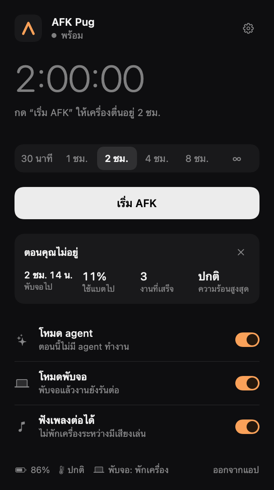</td>
<td valign="top">

**หมายความว่า:** คุณเปิดจอแล้ว หน้าจอ เสียง และโหมดพลังงานต่ำกลับเป็นเหมือนเดิม การ์ดจะบอกระยะเวลาที่พับจอ แบตที่ใช้ไป จำนวนงานที่เสร็จ และความร้อนสูงสุด

**ต้องทำ:** อ่านแล้วกด **×**

</td>
</tr>

<tr><td colspan="2"><h3>หยุดเพราะระบบป้องกัน</h3></td></tr>
<tr>
<td valign="top">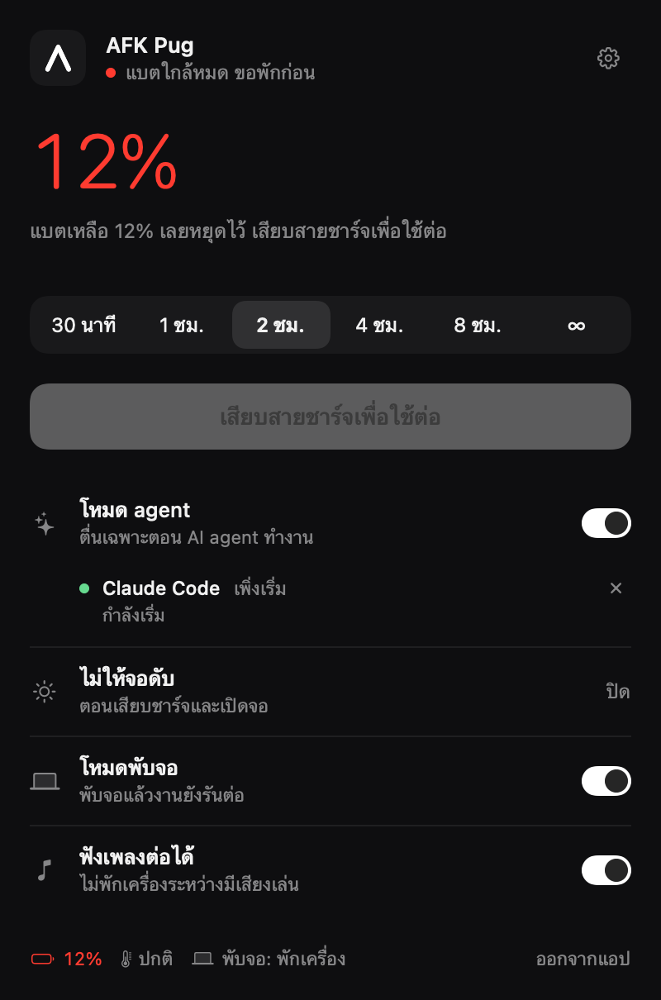</td>
<td valign="top">

**หมายความว่า:** แบตลงถึงระดับที่ตั้งไว้ (ค่าเริ่มต้น 15%) หรือเครื่องร้อนจัด แอปจึงให้เครื่องพักเพื่อป้องกันเครื่อง แม้ agent ยังทำงานอยู่

**ต้องทำ:** เสียบสายชาร์จ หรือรอให้เครื่องเย็นลง ดูเพิ่มที่[ความปลอดภัย](#safety)

</td>
</tr>
</table>

---

<a id="features"></a>

## ฟีเจอร์

### ปรับหน้าตาเอง

เลือกได้ที่ **ตั้งค่า → หน้าตา** กดที่สีแล้วเปลี่ยนทันที **พื้นหลัง** จะตามเครื่อง ขาว ดำ กรมท่า เขียวเข้ม ม่วงเข้ม หรือเลือกสีเองก็ได้ ส่วน **สีหลัก** ใช้กับสวิตช์และโลโก้ในแอป มีสีสำเร็จรูป 6 สี ถ้าอยากได้สีอื่น กดวงกลมสีรุ้งเพื่อลากเลือกบนแผงสีหรือพิมพ์รหัสสี

สีตัวอักษรจะปรับตามพื้นหลังจนอ่านออกเสมอ ไม่ว่าจะเลือกสีคู่ไหน ส่วนเขียว เหลือง และแดงยังคงหมายถึงทำงาน รอ และเตือนเหมือนเดิม บน macOS 26 การ์ดจะเป็น Liquid Glass

<p align="center">
  
  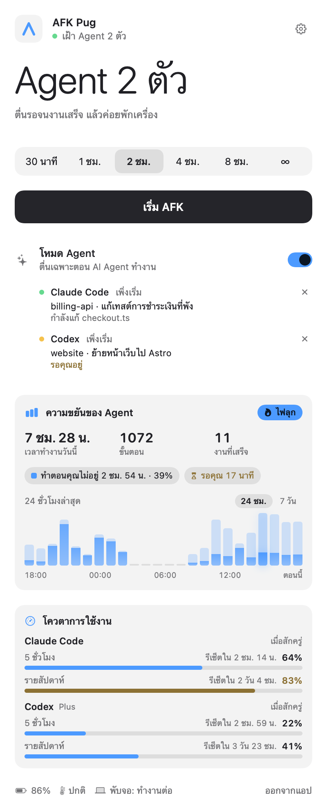
  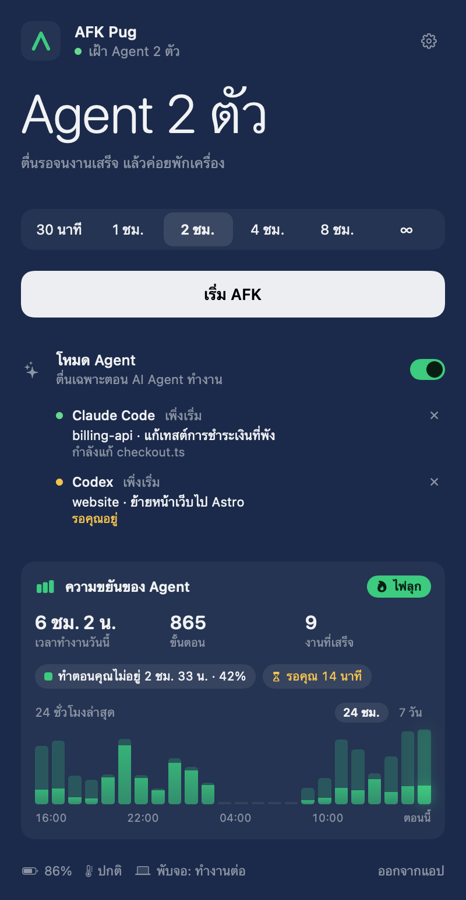
</p>

### เมื่อพับจอ

แอปจัดการให้ทั้งหมด และคืนค่าเดิมเมื่อเปิดจอ:

| สิ่งที่ทำ | ค่าเริ่มต้น | เหตุผล |
|---|---|---|
| ปิดหน้าจอ | เปิด | Mac ชิป Apple Silicon อาจปล่อยให้จอสว่างใต้ฝาพับ จึงสั่งซ้ำตลอดที่พับจอ |
| ปิดเสียง | เปิด | ไม่ทำถ้ากำลังเล่นเพลง |
| โหมดพลังงานต่ำตอนใช้แบต | เปิด | เปิดเองด้วยถ้าเครื่องร้อน |
| ล็อกหน้าจอ | เปิด | กันคนอื่นใช้เครื่องตอนคุณไม่อยู่ |
| หยุดแอปแชทชั่วคราว | ปิด | Slack, Discord, LINE และอื่นๆ แอปแชทที่กำลังโทรอยู่จะไม่ถูกหยุด |

### ดูสถานะได้ทันที

เปิด **ตั้งค่า → ทั่วไป → แสดงสถานะบน menu bar** เพื่อดูเวลาที่เหลือ (`1:45`) หรือจำนวน agent ที่ทำงานอยู่ (`2`) ข้างตัว A ค่าเริ่มต้นปิดไว้ เพราะ MacBook ที่มีรอยบากมีพื้นที่น้อย

### ไม่ให้จอดับ

ปกติจอจะดับเองตามเวลาของเครื่องระหว่างที่ agent ทำงาน ถ้าอยากให้จอติดไว้เพื่อดูงาน เลือกได้ที่แถว **ไม่ให้จอดับ** ใน **ตั้งค่า → ให้เครื่องตื่น**

| ตัวเลือก | จอจะเปิดอยู่ |
|---|---|
| **ปิด** (ค่าเริ่มต้น) | ตามเวลาปกติของเครื่อง |
| **จน agent เสร็จ** | จน agent ตัวสุดท้ายเสร็จ |
| **เสร็จแล้วอีก 30 นาที** | ตอน agent ทำงาน และต่ออีก 30 นาที |
| **เสร็จแล้วอีก 1 ชม.** | ตอน agent ทำงาน และต่ออีก 1 ชั่วโมง |

ใช้ได้เฉพาะตอนเสียบชาร์จและเปิดจออยู่ ถ้าถอดสายชาร์จ พับจอ กด **ให้พักได้เลย** เจอตัวกันความปลอดภัย หรือกด **×** ที่ agent ตัวสุดท้าย จะจบก่อนเวลา ระหว่างเวลาที่ต่อให้ เครื่องจะไม่พักด้วย และแอปจะนับถอยหลังให้เห็น

### เริ่มเองอัตโนมัติ

ปิดไว้ทั้งคู่เป็นค่าเริ่มต้น เปิดได้ที่ **ตั้งค่า → เริ่มอัตโนมัติ**:

- **เมื่อเสียบสายชาร์จ**
- **ระหว่างที่แอปเหล่านี้เปิดอยู่:** ใช้ชื่อตามที่แสดงใน Dock เช่น `Xcode, Docker Desktop, OBS`

### แจ้งเตือนบน Mac และมือถือ

แอปจะบอกเมื่อ agent ทำเสร็จ ขอสิทธิ์ หรือเจอ error การแจ้งว่า "เสร็จแล้ว" จะส่งเมื่อ agent หยุดจริงเท่านั้น ตอนใช้แบต แอปจะเตือนล่วงหน้าเมื่อแบตเหลือมากกว่าระดับที่ตั้งไว้ 5% ก่อนต้องหยุด

ถ้า agent รอให้กดอนุญาตตอนพับจอ การแจ้งเตือนจะบอกว่าเครื่องจะพักในราว 15 นาทีถ้า agent ไม่ทำงานต่อ ส่วนข้อความถึงมือถือจะส่งออกก่อนเครื่องหลับ

สำหรับมือถือ ติดตั้งแอป [ntfy](https://ntfy.sh) ซึ่งใช้ฟรี แล้ว subscribe ชื่อ topic ที่มีแค่คุณรู้ จากนั้นใส่ชื่อเดียวกันที่ **ตั้งค่า → แจ้งเตือนถึงมือถือ** แล้วกด **ทดสอบ**

### ใช้กับ agent ไหนได้บ้าง

| Agent | แอปรู้ได้อย่างไรว่ากำลังทำงาน |
|---|---|
| Claude Code | Hook ใน `~/.claude/settings.json` หรือ[ปลั๊กอิน](#e) ถ้าไม่มีความเคลื่อนไหว 15 นาทีจะเลิกนับ เว้นแต่ process ของ Claude ยังทำงานอยู่ |
| Codex | Hook ใน `~/.codex/hooks.json` หลังเชื่อถือด้วย `/hooks` |
| Gemini CLI | Hook ใน `~/.gemini/settings.json` |
| Cursor (agent ในแอปและ `cursor-agent`) | Hook ใน `~/.cursor/hooks.json` ใช้เฉพาะ event สำหรับสังเกตการณ์ จึงไม่กระทบสิ่งที่คุณอนุมัติ |
| Aider, OpenCode, Amp, Goose, Qwen Code | ตรวจจับ process (**ตั้งค่า → AI agent → ตรวจจับ agent อื่นด้วย**) นับว่าทำงานเมื่อ process ใช้ CPU |
| อื่นๆ | [คำสั่ง `afkpug`](#cli) |

แอปแก้เฉพาะส่วนของตัวเอง เขียนผ่าน symlink ได้ เก็บไฟล์เวอร์ชันแรกสุดไว้เป็น `<file>.afkpug-backup` และไม่แตะไฟล์ที่เป็น read-only

<a id="cli"></a>

### Command line

CLI อยู่ที่ `~/.afkpug/bin/afkpug` เพิ่มเข้า PATH ได้ด้วย:

```sh
export PATH="$HOME/.afkpug/bin:$PATH"
```

```sh
afkpug run -- npm run build              # ให้เครื่องตื่นระหว่างรันคำสั่ง (exit code และ Ctrl-C ส่งผ่านตามปกติ)
afkpug hold --for 1h30m --reason deploy  # 90s, 45m, 2h, 1h30m; ตัวเลขเปล่าๆ คือนาที; สูงสุด 24h
afkpug release                           # ปล่อย hold จาก CLI และเครื่องมือของ agent
afkpug status                            # แอปรันอยู่ไหม และ hold ทั้งหมดพร้อมเวลาที่เหลือ
```

### คำสั่ง URL

สำหรับ Shortcuts, Raycast, Alfred หรือสคริปต์:

```sh
open "afkpug://start?minutes=90"   # 0 = จนกว่าจะหยุดเอง
open "afkpug://stop"
open "afkpug://toggle"
open "afkpug://sleep-now"           # เหมือนปุ่มให้พักได้เลย
```

### ให้ agent ขอเอง (MCP)

ที่ **ตั้งค่า → AI agent → ให้ agent สั่งไม่ให้เครื่องพักได้เอง** แอปจะลงทะเบียน MCP server กับ Claude Code เหมาะกับ build หรือ deploy ที่ยังรันหลัง agent ตอบแล้ว [ปลั๊กอิน](#e)มี server นี้ให้อยู่แล้ว

| เครื่องมือ | หน้าที่ |
|---|---|
| `keep_mac_awake` | ให้เครื่องตื่น 1–720 นาที พร้อมระบุเหตุผล |
| `release_mac_awake` | ปล่อย hold ที่ session นี้สร้าง |
| `afk_status` | แสดงสิ่งที่ทำให้เครื่องตื่นอยู่ |

---

<a id="settings"></a>

## ตั้งค่า

กดรูปเฟืองมุมขวาบนของแอป

| หมวด | การตั้งค่า | ค่าเริ่มต้น |
|---|---|---|
| **ให้เครื่องตื่น** | โหมดพับจอ: ต้องให้สิทธิ์ครั้งเดียว กด **อนุญาต** | เปิด |
| | ไม่ให้จอดับ: ปิด, จน agent เสร็จ, เสร็จแล้วอีก 30 นาที หรือ 1 ชม. | ปิด |
| | ฟังเพลงต่อได้ | เปิด |
| **เมื่อพับจอ** | ปิดหน้าจอ · ปิดเสียง · โหมดพลังงานต่ำตอนใช้แบต · ล็อกหน้าจอ | เปิด |
| | หยุดแอปแชทชั่วคราว | ปิด |
| | เฉพาะตอนเสียบสายชาร์จ: ถ้าใช้แบต พับจอแล้วเครื่องจะพักตามปกติ | ปิด |
| **ความปลอดภัย** | หยุดเมื่อแบตเหลือ 5% ถึง 50% | 15% |
| **AI agent** | แจ้งเตือน | เปิด |
| | รอก่อนพักเครื่อง: ปิด, 2, 5 หรือ 15 นาที | 2 นาที |
| | เชื่อมต่อหรือยกเลิก Claude Code, Codex, Gemini CLI, Cursor | คุณเลือกเอง |
| | ตรวจจับ agent อื่นด้วย | เปิด |
| | ให้ agent สั่งไม่ให้เครื่องพักได้เอง (MCP) | ยังไม่เชื่อมต่อ |
| **แจ้งเตือนถึงมือถือ** | ชื่อ topic ของ ntfy | ว่าง |
| **เริ่มอัตโนมัติ** | เมื่อเสียบสายชาร์จ · ระหว่างที่แอปเหล่านี้เปิดอยู่ | ปิด |
| **หน้าตา** | พื้นหลัง: ตามเครื่อง, ขาว, ดำ, สีเข้ม 3 สี หรือเลือกเอง | ดำ |
| | สีหลัก: สีสำเร็จรูป 6 สี หรือเลือกเอง | ขาว |
| **ทั่วไป** | เปิดเองตอนเปิดเครื่อง | เปิด |
| | แสดงสถานะบน menu bar | ปิด |
| | เช็กเวอร์ชันใหม่: วันละครั้ง | เปิด |
| | ดูหน้าแนะนำอีกครั้ง | |
| | <kbd>⌥</kbd> <kbd>⌘</kbd> <kbd>A</kbd> เริ่มหรือหยุด AFK | เปิด |
| | ภาษา: English, ไทย หรือตาม macOS | English |
| **ประวัติ** | สิ่งที่แอปทำล่าสุด | |
| **สำหรับนักพัฒนา** | คำสั่ง command line และ URL | |

---

<a id="safety"></a>

## ความปลอดภัย

MacBook ที่พับจอระบายความร้อนได้ช้าลง แอปจึงมีระบบป้องกันหลายชั้น:

- **ระดับแบตขั้นต่ำ** เตือนล่วงหน้า 5% แล้วหยุดเมื่อแบตเหลือ 15% (ปรับได้ตั้งแต่ 5% ถึง 50%) แล้วให้เครื่องพัก
- **ความร้อน** เปิดโหมดพลังงานต่ำเมื่อเครื่องร้อน และหยุดเสมอเมื่อถึงระดับวิกฤต ปิดระบบนี้ไม่ได้
- **ปลอดภัยแม้แอปแครช** ถ้าแอปปิดหรือแครช watchdog ของ launchd จะคืนการพักเครื่องปกติภายใน 30 วินาที และให้แอปที่ถูกหยุดทำงานต่อ เมื่อเปิดแอปครั้งถัดไปจะตรวจซ้ำอีกครั้ง
- **สิทธิ์แคบที่สุด** การตั้งค่าครั้งเดียวจะเพิ่มกฎ sudoers สำหรับ 6 คำสั่งเท่านั้น: `pmset -a disablesleep 0|1` และ `pmset -b|-c lowpowermode 0|1` เฉพาะแหล่งไฟที่ใช้อยู่ การตั้งค่าโหมดพลังงานต่ำของคุณจึงไม่เปลี่ยน ลบได้ทุกเมื่อในหน้าตั้งค่า

> [!WARNING]
> วางเครื่องบนพื้นผิวแข็งที่ระบายอากาศได้ อย่าใส่กระเป๋าระหว่างที่เครื่องตื่นอยู่

## ความเป็นส่วนตัว

ทุกอย่างอยู่ในเครื่องคุณ ไม่ต้องมีบัญชี และไม่เก็บข้อมูลการใช้งาน

- **ข้อมูลว่า agent ทำอะไรอยู่:** hook จะเก็บชื่อโฟลเดอร์ ข้อความที่คุณสั่ง ขั้นตอนปัจจุบัน และแอปกับ terminal ที่รันอยู่ไว้ที่ `~/.afkpug/tasks` ซึ่งอ่านได้เฉพาะคุณ แต่ละไฟล์จะถูกลบเมื่อขึ้นในรายการแล้ว หรือภายในราว 1 ชั่วโมง คำสั่งที่รันจะแสดงแค่ 2 คำแรก
- **การแจ้งเตือนถึงมือถือ** ไม่มีข้อมูลเหล่านี้ และส่งไปยัง topic ของ ntfy ที่คุณกรอกเท่านั้น ถ้าคุณตั้งไว้
- **การเช็กเวอร์ชันใหม่** ถาม GitHub วันละครั้งโดยไม่ส่งข้อมูลของคุณ ปิดได้ที่ **ตั้งค่า → ทั่วไป → เช็กเวอร์ชันใหม่**
- **ไฟล์อัปเดต** จะถูกตรวจ checksum จาก GitHub, ID และเวอร์ชันของแอป และลายเซ็นโค้ดก่อนติดตั้ง

แอปออกเน็ตแค่ 2 กรณีนี้เท่านั้น

---

<a id="help"></a>

## แก้ปัญหา

<a id="missing-icon"></a>

### ไม่เห็นไอคอน A

บน MacBook ที่มีรอยบาก macOS จะซ่อนไอคอนบน menu bar เมื่อพื้นที่ไม่พอ โดยไม่แจ้งเตือน ให้ปิดแอปอื่นบน menu bar บางตัว หรือกด <kbd>⌘</kbd> ค้างแล้วลากไอคอนอื่นออก ถ้าแอปไม่ได้เปิดอยู่ ให้เปิดจาก Applications

<details>
<summary><b>พับจอแล้วเครื่องยังพัก</b></summary>
<br>

เปิด **ตั้งค่า → ให้เครื่องตื่น** แล้วดู **โหมดพับจอ** ถ้าขึ้นว่าต้องให้สิทธิ์ ให้กด **อนุญาต** จากนั้นเช็กว่ามีอะไรทำให้เครื่องตื่นอยู่ไหม เช่น agent, ตัวนับเวลา หรือเพลง ถ้าไม่มีงาน เครื่องควรพักอยู่แล้ว ตัวเลือก **เฉพาะตอนเสียบสายชาร์จ** ก็ทำให้เครื่องพักตอนใช้แบตด้วย

</details>

<details>
<summary><b>กดให้พักได้เลยแล้วเครื่องยังไม่พัก</b></summary>
<br>

ปุ่ม **ให้พักได้เลย** แค่เลิกกันเครื่องหลับ macOS จะพักตามเวลาของมันเอง และแอปอื่นอาจกันเครื่องหลับอยู่ ดูว่าเป็นแอปไหนด้วยคำสั่ง `pmset -g assertions` ใน Terminal ถ้าอยากให้พักทันที ใช้เมนู Apple หรือพับจอ

</details>

<details>
<summary><b>แอปไม่เห็น agent ของฉัน</b></summary>
<br>

ไปที่ **ตั้งค่า → AI agent** แล้วกด **เชื่อมต่อ** ถ้าใช้ Codex ให้เปิด Codex แล้วพิมพ์ `/hooks` เพื่อเชื่อถือ hook ด้วย ส่วน agent อื่นต้องเปิด **ตรวจจับ agent อื่นด้วย** และจะนับเฉพาะตอนใช้ CPU

</details>

<details>
<summary><b>อัปเดตแล้วแอปขอสิทธิ์โหมดพับจออีกครั้ง</b></summary>
<br>

การอัปเกรดจาก 0.1 เปลี่ยนกฎสิทธิ์ จึงต้องกด <b>อนุญาต</b> อีกครั้ง กฎนี้ยังอนุญาตเฉพาะคำสั่งที่อยู่ใน<a href="#safety">ความปลอดภัย</a>

</details>

<details>
<summary><b>พับจอแล้วเน็ตยังต่ออยู่ไหม</b></summary>
<br>

เครื่องไม่ได้พัก Wi-Fi จึงมักต่ออยู่ตามปกติ ดาวน์โหลด, SSH และการซิงก์ทำงานต่อได้ แต่สัญญาณที่อ่อน เช่น hotspot มือถือ อาจหลุดเองได้

</details>

<details>
<summary><b>ต่างจาก Amphetamine อย่างไร</b></summary>
<br>

Amphetamine ทำให้เครื่องตื่นตามเวลาที่ตั้ง ส่วน AFK Pug ยังปิดจอและปิดเสียงเมื่อพับจอ รู้ว่า agent ทำงานอยู่ไหม และให้เครื่องพักทันทีที่งานเสร็จ

</details>

<details>
<summary><b>ถ้าลืมปิดล่ะ</b></summary>
<br>

ตัวนับเวลาจบเอง โหมด agent จบเมื่องานจบ และการปิดแอปจะคืนการพักเครื่องปกติ ถ้าแอปแครช watchdog จะคืนค่าให้ภายใน 30 วินาที

</details>

---

## สำหรับนักพัฒนา

รายละเอียดวิธีทำงาน การทดสอบ และโครงสร้างโปรเจกต์อยู่ที่[ส่วน Development ใน README ภาษาอังกฤษ](README.md#development)

ผลงานของ [Pug-03](https://github.com/Pug-03) ผู้สร้าง [PushPug](https://github.com/Pug-03/PushPug) · [สัญญาอนุญาต MIT](LICENSE) · [ประวัติการเปลี่ยนแปลง](CHANGELOG.md)
